<p align="center">
  
</p>

# NKRoots.jl

A Newton–Krylov solver for systems of nonlinear equations, $F(x) = 0$, in Julia. It uses only the
product of the Jacobian with a vector, so it suits large systems, and the unknown `x` can be any
type that broadcasts.

The package has four parts, and this page follows them.

- **The interface.** One function, `nkroot!`. The Jacobian is a finite difference, dual numbers or
  an operator of your own.
- **Globalisation.** Classical Newton, backtracking along the Newton step, or a trust region in the
  Krylov space, the hookstep. The radius of the trust region follows the classical rule or one of
  two scans, and the hookstep can carry a second-order correction, the geodesic acceleration.
- **Preconditioning.** A right preconditioner, fixed or moved with the point, with the trust region
  kept on the step in `x`. Flexible GMRES is at hand for preconditioners that stretch a few
  directions.
- **Tracing.** A callback at every iteration, and `Trace`, which records what a search does.

Two larger examples from fluid dynamics follow, and then the mathematics of the method.

**Contents.**
[Installation](#installation) ·
[A first search](#a-first-search) ·
[The interface](#the-interface) ·
[The Krylov space](#the-krylov-space) ·
[Globalisation](#globalisation) ·
[Preconditioning](#preconditioning) ·
[Tracing and callbacks](#tracing-and-callbacks) ·
[Examples](#examples) ·
[How it works](#how-it-works) ·
[Tests](#tests) ·
[References](#references)

## Installation

```julia
using Pkg
Pkg.add(url="https://github.com/Davide-Lasagna-s-Lab/NKRoots.jl")
```

Each example is a folder of `examples/`, with its script and the figure that the script writes.
The examples share one environment, `examples/Project.toml`, with CairoMakie for the figures. Every
number and figure on this page comes from one of them. A script is run from the root of the
repository.

```
julia --project=examples -e 'using Pkg; Pkg.instantiate()'
julia --project=examples examples/route/route.jl
```

## A first search

Two equations in two unknowns, the circle $x_1^2 + x_2^2 = 2$ and the curve
$e^{x_1 - 1} + x_2^3 = 2$. The function writes the residual into `out` and returns it. The guess `x`
is overwritten with the root.

```julia
using NKRoots
using LinearAlgebra

function two!(out, x)
    out[1] = x[1]^2 + x[2]^2 - 2
    out[2] = exp(x[1] - 1) + x[2]^3 - 2
    return out
end

x   = [1.8, 0.7]
out = nkroot!(two!, x; Δ=0.1, tol=1e-12)
```

Each row of the output is one Newton iteration, and the last line says how the search ended.

```
╭──────┬────────────┬───────────┬───────────┬───────────┬─────────┬───────┬────────────┬──────────┬──────╮
│ iter │        ‖F‖ │      ‖δx‖ │         Δ │         λ │       ρ │ dim K │ GMRES res. │     step │ rej. │
├──────┼────────────┼───────────┼───────────┼───────────┼─────────┼───────┼────────────┼──────────┼──────┤
│    0 │ 1.8210e+00 │           │  1.00e-01 │           │         │       │            │          │      │
│    1 │ 1.3909e+00 │  1.00e-01 │  2.00e-01 │  8.67e-02 │   0.976 │     2 │   0.00e+00 │   ↪ hook │    0 │
│    2 │ 6.7069e-01 │  2.00e-01 │  4.00e-01 │  1.68e-01 │   0.973 │     2 │   1.43e-32 │   ↪ hook │    0 │
│    3 │ 3.3101e-01 │  4.00e-01 │  8.00e-01 │  2.97e-01 │   0.967 │     2 │   4.28e-32 │   ↪ hook │    0 │
│    4 │ 1.1106e-01 │  2.69e-01 │  8.00e-01 │  1.00e+00 │   0.887 │     2 │   2.30e-32 │ → newton │    0 │
│    5 │ 1.7982e-03 │  2.60e-02 │  8.00e-01 │  1.00e+00 │   1.000 │     2 │   0.00e+00 │ → newton │    0 │
│    6 │ 1.4706e-06 │  7.37e-04 │  8.00e-01 │  1.00e+00 │   1.000 │     2 │   4.70e-34 │ → newton │    0 │
│    7 │ 9.9517e-13 │  6.14e-07 │  8.00e-01 │  1.00e+00 │   1.000 │     2 │   9.62e-34 │ → newton │    0 │
╰──────┴────────────┴───────────┴───────────┴───────────┴─────────┴───────┴────────────┴──────────┴──────╯
  ✓ converged: 7 steps, ‖F‖ = 9.952e-13, 8 residuals, 14 Jacobian products
```

The function returns `(status = :converged, iter = 7, res = 9.95173797640148e-13)`, and `x` is the
root `(1, 1)`.

The search uses the defaults, a finite-difference Jacobian and the hookstep. The radius `Δ` starts
at 0.1 and doubles while the linear model predicts the residual well, which the ratio `ρ` close to
one says. The first three steps lie on the boundary of the trust region and are a fraction `λ` of
the Newton step. The last four are full Newton steps, and the residual falls quadratically.
[The printed table](#the-printed-table) explains every column.

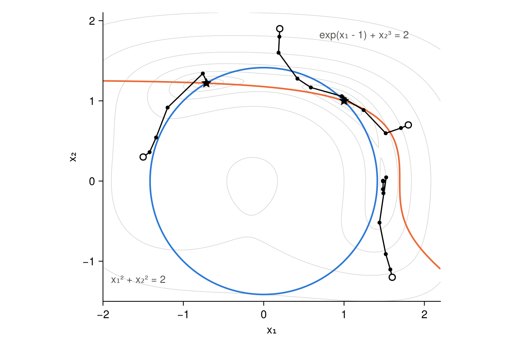

The figure shows four searches on the landscape of $\tfrac12\lVert F\rVert^2$, with the same
settings but for `maxiter=50`. The blue and orange curves are the two equations, and they cross at
the two roots, the stars. Three searches reach a root. The fourth, from `(1.6, -1.2)`, ends in a
valley with no root and stops with the status `:collapsed`. Every accepted step lowers
$\lVert F\rVert$, so a search can end at a local minimum of $\lVert F\rVert$ if the guess leads
there.

Script: [`examples/route/route.jl`](examples/route/route.jl).

## The interface

```julia
nkroot!(F!, x; kwargs...)       # the Jacobian by finite differences or dual numbers
nkroot!(F!, J, x; kwargs...)    # the Jacobian as an operator of your own
```

Both overwrite `x` and return the named tuple `(; status, iter, res)`.

### The function

`F!(out, x)` writes the residual $F(x)$ into `out` and returns `out`. The solver uses the returned
value, so the `return out` is needed. With `jacobian=:ad` the function is also called with dual
numbers in `x` and `out`, so it should not fix the element type. In `two!` above nothing does. In
the examples below a boundary value is written `zero(u[i])` and not `0.0` for the same reason.

### The Jacobian

There are three ways to give it.

| | call | calls of `F!` per product |
|---|---|---:|
| forward difference | `nkroot!(F!, x)`, the default, or `jacobian=:fd` | 1 |
| central difference | `nkroot!(F!, x; difference=:central)` | 2 |
| dual numbers | `nkroot!(F!, x; jacobian=:ad)` | 1 |
| your own operator | `nkroot!(F!, J, x)` | none |

The finite differences are

$$J y \approx \frac{F(x + \varepsilon y) - F(x)}{\varepsilon}, \qquad
J y \approx \frac{F(x + \varepsilon y) - F(x - \varepsilon y)}{2\varepsilon}, \qquad
\varepsilon = \delta\,\frac{1 + \lVert x\rVert}{\lVert y\rVert}.$$

The forward difference is first order in $\varepsilon$ and reuses $F(x)$, which the search has
already. The central one is second order and takes two evaluations. The relative step $\delta$ is
the square root of the machine precision for the forward difference and its cube root for the
central one. Each balances the truncation error, of order $\varepsilon$ or $\varepsilon^2$, against
the rounding of $F$ divided by $\varepsilon$. The keyword `ϵ` sets $\delta$ by hand. The residual
itself is never approximated, so a root found with an approximate Jacobian still satisfies the
equations to `tol`.

Dual numbers give the product exactly, to rounding, at one call of `F!` on dual numbers. They are
the forward mode of automatic differentiation [23]. The product by finite differences is the
matrix-free approximation described by Knoll and Keyes [3].

An operator of your own is any object `J` with two methods. `mul!(out, J, v)` writes the product
$Jv$ into `out`. `NKRoots.update!(J, x, r)` moves the operator to the point `x`, where `r = F(x)`,
and is called once at the start of every Newton iteration. The default `update!` does nothing, which
is right for a constant operator such as a matrix.

```julia
struct TwoJacobian
    A::Matrix{Float64} # the matrix at the last point
end

function NKRoots.update!(J::TwoJacobian, x, r)
    J.A[1, 1] = 2x[1]
    J.A[1, 2] = 2x[2]
    J.A[2, 1] = exp(x[1] - 1)
    J.A[2, 2] = 3x[2]^2
    return J
end

LinearAlgebra.mul!(out, J::TwoJacobian, v) = mul!(out, J.A, v)

settings = (Δ=0.1, tol=1e-13, maxiter=30, verbose=false)

nkroot!(two!, [1.8, 0.7]; settings...)                             # forward differences
nkroot!(two!, [1.8, 0.7]; difference=:central, settings...)        # central differences
nkroot!(two!, [1.8, 0.7]; jacobian=:ad, settings...)               # dual numbers
nkroot!(two!, TwoJacobian(zeros(2, 2)), [1.8, 0.7]; settings...)   # your own operator
nkroot!(two!, [1.8, 0.7]; ϵ=1e-2, settings...)                     # a coarse forward difference
```

The script counts what each search costs.

```
jacobian=:fd                        8 steps, 16 products, 25 calls of F, ‖F‖ = 2.2e-16
jacobian=:fd, difference=:central   8 steps, 16 products, 41 calls of F, ‖F‖ = 0.0e+00
jacobian=:ad                        8 steps, 16 products, 25 calls of F, ‖F‖ = 0.0e+00
your own object                     8 steps, 16 products,  9 calls of F, ‖F‖ = 0.0e+00
jacobian=:fd, ϵ=1e-2               12 steps, 24 products, 37 calls of F, ‖F‖ = 1.3e-14
```

The four accurate Jacobians follow the same path. The coarse finite difference still converges,
because the residual is exact, but it loses the quadratic phase and needs four more steps.

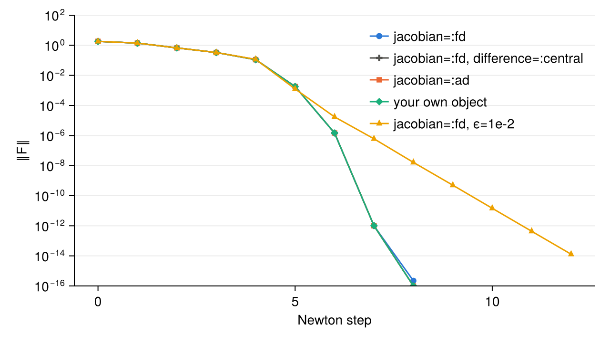

`jacobianFD(F!, x; difference, ϵ)` and `jacobianAD(F!, x)` build the first three operators as
objects, to pass as `J` or to use elsewhere. `J*v` and `mul!(out, J, v)` apply them.

Script: [`examples/jacobians/jacobians.jl`](examples/jacobians/jacobians.jl).

### The vectors

The unknown, the residual and the Krylov vectors have the type of `x`. The solver asks of it
broadcasting, `similar`, `copy`, `dot` and `norm`. The built-in Jacobians also use `eltype`, and
dual numbers use `similar(x, T)`. Lengths, the trust region and the tolerance are all measured by
`norm`.

Here the unknown is a matrix, for the equation $\nabla^2 u + e^u = 0$ on the unit square with
$u = 0$ on the boundary, by second differences on 20 × 20 points.

```julia
m = 20
k = 1/(m + 1)

function square!(out, u)
    at(i, j) = (1 <= i <= m && 1 <= j <= m) ? u[i, j] : zero(u[1, 1])
    for j in 1:m, i in 1:m
        out[i, j] = (at(i - 1, j) + at(i + 1, j) + at(i, j - 1) + at(i, j + 1) - 4u[i, j])/k^2 + exp(u[i, j])
    end
    return out
end

u = zeros(m, m)
nkroot!(square!, u; Δ=1.0, krylov_dim=120, krylov_tol=1e-6, tol=1e-6)
```

```
╭──────┬────────────┬───────────┬───────────┬───────────┬─────────┬───────┬────────────┬──────────┬──────╮
│ iter │        ‖F‖ │      ‖δx‖ │         Δ │         λ │       ρ │ dim K │ GMRES res. │     step │ rej. │
├──────┼────────────┼───────────┼───────────┼───────────┼─────────┼───────┼────────────┼──────────┼──────┤
│    0 │ 2.0000e+01 │           │  1.00e+00 │           │         │       │            │          │      │
│    1 │ 2.7884e-02 │  9.11e-01 │  1.00e+00 │  1.00e+00 │   1.000 │    32 │   4.72e-07 │ → newton │    0 │
│    2 │ 8.8771e-08 │  1.47e-03 │  1.00e+00 │  1.00e+00 │   1.000 │    27 │   6.58e-07 │ → newton │    0 │
╰──────┴────────────┴───────────┴───────────┴───────────┴─────────┴───────┴────────────┴──────────┴──────╯
  ✓ converged: 2 steps, ‖F‖ = 8.877e-08, 3 residuals, 59 Jacobian products
```

The Krylov basis is a vector of copies of `x` by default. A type of vectors can store its basis
together, for instance as the columns of one matrix, and orthogonalise a vector against all of them
at once. It does so with methods of `NKRoots._basis`, `NKRoots._push!`, `NKRoots._orthogonalise!`
and `NKRoots.lincomb!`, and of `length`, `getindex` and `empty!` on the container. The test
"a type of vectors can bring its own basis" in [`test/test_claims.jl`](test/test_claims.jl) is a
complete example.

Script: [`examples/vectors/vectors.jl`](examples/vectors/vectors.jl).

### The keywords

The Jacobian, for `nkroot!(F!, x)` only.

| keyword | default | meaning |
|---|---|---|
| `jacobian` | `:fd` | `:fd` for finite differences, `:ad` for dual numbers |
| `difference` | `:forward` | `:forward` or `:central`, with `jacobian=:fd` |
| `ϵ` | `nothing` | the relative step $\delta$ of the finite difference, or `nothing` for the default |

The Krylov space, in [its section](#the-krylov-space).

| keyword | default | meaning |
|---|---|---|
| `krylov_dim` | `50` | largest dimension of the Krylov space |
| `krylov_tol` | `1e-3` | relative residual of GMRES at which the space stops growing |

The step, in [Globalisation](#globalisation).

| keyword | default | meaning | used by |
|---|---|---|---|
| `globalisation` | `:hookstep` | `:hookstep`, `:backtracking` or `:none` | |
| `eta` | `1e-3` | smallest ratio of the actual to the predicted reduction of $\lVert F\rVert^2$ for a step to be accepted | hookstep, backtracking |
| `Δmax` | `Inf` | largest radius, and largest step of backtracking | hookstep, backtracking |
| `Δ` | `1e-2` | first radius of the trust region, capped by `Δmax` | hookstep |
| `trust` | `:classical` | `:classical` or `:scan`, the rule of the radius | hookstep |
| `scan` | `:greedy` | `:greedy` or `:longest`, the trial that a scan keeps | hookstep with `trust=:scan` |
| `acceleration` | `:none` | `:none` or `:geodesic`, the second-order correction | hookstep |
| `alpha` | `0.75` | longest acceleration accepted, relative to the velocity | `acceleration=:geodesic` |

The preconditioner, in [Preconditioning](#preconditioning).

| keyword | default | meaning |
|---|---|---|
| `precond` | `nothing` | right preconditioner `M`, an object with `ldiv!(out, M, v)` |
| `flexible` | `false` | flexible GMRES, which keeps the vectors $M^{-1}q_j$ |

The end of the search and the output, [below](#the-return-value-and-the-end-of-a-search) and in
[Tracing and callbacks](#tracing-and-callbacks).

| keyword | default | meaning |
|---|---|---|
| `tol` | `1e-10` | the search converges when $\lVert F\rVert$ falls below it |
| `maxiter` | `20` | Newton iterations at most |
| `callback` | `info -> false` | called at the start and after every iteration, stops the search by returning `true` |
| `verbose` | `true` | print the table |
| `io` | `stdout` | where to print it |

A keyword that is not one of the listed symbols throws an `ArgumentError`, and so does
`acceleration=:geodesic` without the hookstep.

### The return value and the end of a search

`nkroot!` returns `(; status, iter, res)`, with the number of iterations and the last residual
norm. On return `x` holds the last accepted point, whatever the status.

| `status` | the search ended because |
|---|---|
| `:converged` | $\lVert F(x)\rVert$ < `tol` |
| `:maxiter` | `maxiter` iterations were made |
| `:collapsed` | no step was accepted |
| `:stopped` | the callback returned `true` |

The tolerance is absolute, on the `norm` of the residual. Rounding in $F$ sets a floor on that
norm, and a `tol` below the floor cannot be met. On the upper solution of the Bratu problem used
below, where the entries of the second differences are of order $4\times10^4$, the residual stalls
between $10^{-10}$ and $10^{-9}$, and the examples ask for $10^{-8}$.

A search collapses when the globalisation finds no acceptable step longer than the rounding of the
point, $\epsilon_{\text{mach}}\,(1 + \lVert x\rVert)$. For the hookstep this is a radius below that
length, for backtracking a step below it. Classical Newton collapses only when the residual stops
being a finite number. A collapse far from a root is the sign of a local minimum of
$\lVert F\rVert$, as in [the first search](#a-first-search), or of a Jacobian that is wrong.

### The printed table

The table has the same columns for every globalisation.

| column | meaning |
|---|---|
| `iter` | the Newton iteration, 0 for the guess |
| `‖F‖` | the norm of the residual after the step |
| `‖δx‖` | the length of the accepted step |
| `Δ` | the radius of the trust region for the next iteration. Blank without a trust region, with backtracking and classical Newton |
| `λ` | the fraction of the Newton step taken, $\lVert\delta x\rVert$ over the length of the GMRES step |
| `ρ` | the actual reduction of $\lVert F\rVert^2$ over the one predicted by the linear model |
| `dim K` | the dimension of the Krylov space |
| `GMRES res.` | the relative residual of the GMRES solution of the Newton system, for the full step before the globalisation |
| `step` | `→ newton` the GMRES step, `↪ hook` a hookstep on the boundary of the trust region, `↓ line` the GMRES step shortened by backtracking |
| `rej.` | the trial steps rejected before the accepted one |

The fraction `λ` is one for a `→ newton` step. With backtracking it is the factor by which the step
was shortened. For a hookstep it compares the length of the step with that of the Newton step, and
the two also differ in direction.

## The Krylov space

Each Newton iteration solves the linear system $J\,\delta x = -F(x)$ approximately, by GMRES in a
Krylov space built by the Arnoldi iteration. One vector of the space costs one product with the
Jacobian. Two keywords say when the space stops growing.

- `krylov_tol` is the relative residual of the Newton system, $\lVert F + J\delta x\rVert / \lVert F\rVert$,
  at which GMRES stops.
- `krylov_dim` is the largest dimension. There is no restart, so the step comes from the space of
  that dimension.

The examples of this page share one problem, the Bratu problem $u'' + e^u = 0$ with
$u(0) = u(1) = 0$, by second differences on 200 points. The matrix `A` of the second differences
serves as a preconditioner.

```julia
n = 200
h = 1/(n + 1)

function bratu!(out, u)
    for i in 1:n
        left   = i == 1 ? zero(u[i]) : u[i - 1]
        right  = i == n ? zero(u[i]) : u[i + 1]
        out[i] = (left - 2u[i] + right)/h^2 + exp(u[i])
    end
    return out
end

A = Tridiagonal(fill(1/h^2, n - 1), fill(-2/h^2, n), fill(1/h^2, n - 1))

u = zeros(n)
nkroot!(bratu!, u; precond=lu(A), krylov_tol=1e-2, krylov_dim=10, Δ=1.0, tol=1e-10, maxiter=40, verbose=false)
```

The figure shows searches from $u = 0$ with `precond=lu(A)`, `Δ=1`, `tol=1e-10` and `maxiter=40`.
On the left `krylov_tol` varies and `krylov_dim` is 50. On the right `krylov_dim` varies and
`krylov_tol` is $10^{-8}$.


A loose tolerance gives cheap iterations that converge linearly, and a tight one fewer iterations
with more products each. [How it works](#how-well-to-solve-the-newton-system) gives the reason. A
space of one vector still converges, more slowly. The right choice depends on what a product costs
against a residual, and `1e-3` is a middle value.

Script: [`examples/krylov/krylov.jl`](examples/krylov/krylov.jl).

## Globalisation

Far from a root the Newton step is unreliable, because the linear model behind it holds only near
the point. A globalisation turns the linear model into a step that lowers the residual. Three are
available, and the hookstep has variants.

| keywords | the step |
|---|---|
| `globalisation=:none` | the GMRES step as it is, classical Newton |
| `globalisation=:backtracking` | the GMRES step, halved until the residual falls enough |
| `globalisation=:hookstep`, `trust=:classical` | the best step of the Krylov space within a radius, which moves after each trial |
| `globalisation=:hookstep`, `trust=:scan`, `scan=:greedy` | the same at thirteen radii, keeping the smallest residual |
| `globalisation=:hookstep`, `trust=:scan`, `scan=:longest` | the same at the largest radius that still lowers the residual |
| `acceleration=:geodesic`, with either rule | a hookstep with a second-order correction |

All of them build the same Krylov space and differ in the trials they make inside it. A trial costs
one evaluation of $F$ and no product with the Jacobian.

### One problem for all

The subsections below run the same search with each method. It is the Bratu problem of the last
section from a tall guess, $u = 10\sin(\pi x)$. The problem has two solutions, and from this guess
the searches that converge find the upper one. The settings are common, 200 points, the Jacobian by
dual numbers, `precond=lu(A)`, `krylov_tol=1e-6`, `krylov_dim=50`, `tol=1e-8`, `eta=1e-3`,
`maxiter=100`, and a first radius `Δ=1` for the hookstep.

```julia
guess()  = [10*sin(π*i*h) for i in 1:n]
settings = (jacobian=:ad, precond=lu(A), krylov_tol=1e-6, tol=1e-8, maxiter=100, verbose=false)
```

| method | status | iterations | residuals | products | calls of `F!` |
|---|---|---:|---:|---:|---:|
| `globalisation=:none` | `:maxiter`, $\lVert F\rVert = 4.8\times10^{9}$ | 100 | 101 | 4123 | 4224 |
| `globalisation=:backtracking` | `:collapsed`, $\lVert F\rVert = 5.6\times10^{3}$ | 32 | 640 | 551 | 1191 |
| `trust=:classical` | `:converged` | 21 | 24 | 275 | 299 |
| `trust=:scan, scan=:greedy` | `:converged` | 12 | 89 | 143 | 232 |
| `trust=:scan, scan=:longest` | `:converged` | 40 | 110 | 500 | 610 |
| `trust=:classical, acceleration=:geodesic` | `:converged` | 18 | 33 | 243 | 276 |
| `trust=:scan, scan=:longest, acceleration=:geodesic` | `:converged` | 13 | 42 | 153 | 195 |

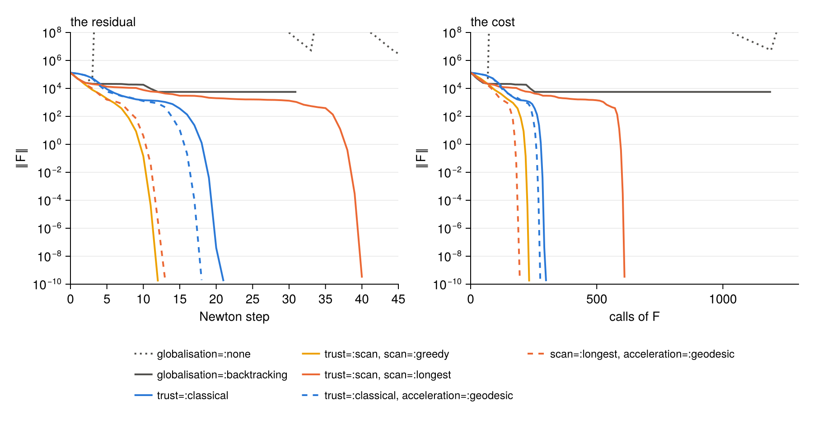

The outcome depends on the guess, so the script repeats the seven searches from the guesses
$a\sin(\pi x)$ with $a = 1, \dots, 20$.

```
globalisation=:none                        10 of 20  ✓✓✓✓✓✓·✓✓··✓··✓·····
globalisation=:backtracking                10 of 20  ✓✓✓✓✓✓·✓✓··✓··✓·····
trust=:classical                           20 of 20  ✓✓✓✓✓✓✓✓✓✓✓✓✓✓✓✓✓✓✓✓
trust=:scan, scan=:greedy                  20 of 20  ✓✓✓✓✓✓✓✓✓✓✓✓✓✓✓✓✓✓✓✓
trust=:scan, scan=:longest                 20 of 20  ✓✓✓✓✓✓✓✓✓✓✓✓✓✓✓✓✓✓✓✓
trust=:classical, acceleration=:geodesic   20 of 20  ✓✓✓✓✓✓✓✓✓✓✓✓✓✓✓✓✓✓✓✓
scan=:longest, acceleration=:geodesic      20 of 20  ✓✓✓✓✓✓✓✓✓✓✓✓✓✓✓✓✓✓✓✓
```

On this problem classical Newton and backtracking converge from half of the guesses, the same
half, and the hookstep from all of them with every rule. Where the first two converge they are
cheap, since they spend one residual per iteration.

Script: [`examples/globalisation/globalisation.jl`](examples/globalisation/globalisation.jl).

### Classical Newton

With `globalisation=:none` the search takes the GMRES step $\delta x_N$ at every iteration,
whatever it does to the residual,

$$x \leftarrow x + \delta x_N, \qquad J\,\delta x_N \approx -F(x).$$

It costs one residual per iteration and has no parameter. Near a root it converges quadratically if
the Newton systems are solved tightly. Use it when the guess is known to be good, for instance along
a continuation in a parameter with small increments. The keywords `Δ`, `Δmax`, `eta`, `trust` and
`scan` play no part.

The values in the comments of this section are what the lines return. Their last digits depend on
the rounding of the run, and the iteration counts do not.

```julia
nkroot!(bratu!, guess(); globalisation=:none, settings...)
# (status = :maxiter, iter = 100, res = 4.770417126748984e9)
```

From the tall guess the first steps raise the residual by many orders of magnitude, and the search
does not recover in 100 iterations.

### Backtracking

With `globalisation=:backtracking` the search keeps the direction of the GMRES step and shortens
it. It tries $\lambda\,\delta x_N$ with $\lambda = 1, \tfrac12, \tfrac14, \dots$ and accepts the
first trial whose ratio of actual to predicted reduction exceeds `eta`,

$$\rho(\lambda) = \frac{\lVert F(x)\rVert^2 - \lVert F(x + \lambda\,\delta x_N)\rVert^2}
{\lVert F(x)\rVert^2 - \lVert F(x) + \lambda J\,\delta x_N\rVert^2} > \eta.$$

The denominator is the reduction that the linear model predicts for the shortened step.
`Δmax` caps the length of the first trial, and `Δ`, `trust` and `scan` play no part. A shortened
step is printed as `↓ line`, and the column `λ` holds the fraction taken.

Backtracking costs one residual per trial and no dense algebra. It suits problems where the Newton
direction is good and only too long. Its weak point is a Jacobian close to singular. The Newton
step is then very long, in a direction that the linear model follows only for a short distance, and
the accepted fraction becomes tiny. On the test problem this happens at the point where the search
stops. The Jacobian there has a condition number near $7\times10^{10}$, the last accepted steps are
fractions $2^{-37}$ to $2^{-58}$ of the Newton step, and the search ends as `:collapsed` far from
the root.

```julia
nkroot!(bratu!, guess(); globalisation=:backtracking, settings...)
# (status = :collapsed, iter = 32, res = 5636.997565489263)
```

A search where backtracking works is $\arctan(x) = 0$ in three unknowns from $x = 10$, where
classical Newton overshoots and diverges.

```julia
arctan!(out, x) = (out .= atan.(x); out)

x = fill(10.0, 3)
nkroot!(arctan!, x; jacobian=:ad, globalisation=:backtracking, maxiter=50)
```

```
╭──────┬────────────┬───────────┬───────────┬───────────┬─────────┬───────┬────────────┬──────────┬──────╮
│ iter │        ‖F‖ │      ‖δx‖ │         Δ │         λ │       ρ │ dim K │ GMRES res. │     step │ rej. │
├──────┼────────────┼───────────┼───────────┼───────────┼─────────┼───────┼────────────┼──────────┼──────┤
│    0 │ 2.5481e+00 │           │           │           │         │       │            │          │      │
│    1 │ 2.5196e+00 │  3.22e+01 │           │  1.25e-01 │   0.095 │     1 │   1.68e-32 │   ↓ line │    3 │
│    2 │ 2.3770e+00 │  2.35e+01 │           │  1.25e-01 │   0.469 │     1 │   1.24e-32 │   ↓ line │    3 │
│    3 │ 2.2811e+00 │  1.53e+01 │           │  2.50e-01 │   0.181 │     1 │   1.72e-32 │   ↓ line │    2 │
│    4 │ 1.6267e+00 │  9.04e+00 │           │  2.50e-01 │   1.123 │     1 │   2.12e-32 │   ↓ line │    2 │
│    5 │ 1.6023e+00 │  4.67e+00 │           │  1.00e+00 │   0.030 │     1 │   1.53e-32 │ → newton │    0 │
│    6 │ 1.5365e+00 │  4.42e+00 │           │  1.00e+00 │   0.080 │     1 │   0.00e+00 │ → newton │    0 │
│    7 │ 1.3569e+00 │  3.85e+00 │           │  1.00e+00 │   0.220 │     1 │   1.34e-32 │ → newton │    0 │
│    8 │ 8.9031e-01 │  2.70e+00 │           │  1.00e+00 │   0.570 │     1 │   2.13e-32 │ → newton │    0 │
│    9 │ 1.9534e-01 │  1.17e+00 │           │  1.00e+00 │   0.952 │     1 │   1.41e-32 │ → newton │    0 │
│   10 │ 1.6732e-03 │  1.98e-01 │           │  1.00e+00 │   1.000 │     1 │   0.00e+00 │ → newton │    0 │
│   11 │ 1.0410e-09 │  1.67e-03 │           │  1.00e+00 │   1.000 │     1 │   2.13e-32 │ → newton │    0 │
│   12 │ 0.0000e+00 │  1.04e-09 │           │  1.00e+00 │   1.000 │     1 │   4.27e-32 │ → newton │    0 │
╰──────┴────────────┴───────────┴───────────┴───────────┴─────────┴───────┴────────────┴──────────┴──────╯
  ✓ converged: 12 steps, ‖F‖ = 0.000e+00, 23 residuals, 12 Jacobian products
```

The first four steps are an eighth and a quarter of the Newton step, after three and two rejected
trials. From the fifth the full step is accepted.

### The hookstep and the classical rule

With `globalisation=:hookstep`, the default, the step is the minimiser of the linear model within a
distance `Δ` of the point,

$$\min_{\delta x \in \mathcal K}\ \lVert F(x) + J\,\delta x\rVert
\quad\text{subject to}\quad \lVert\delta x\rVert \le \Delta,$$

over the Krylov space $\mathcal K$. If the GMRES step is shorter than `Δ` it is the answer, a
`→ newton` step. Otherwise the step lies on the boundary, a `↪ hook` step. Unlike backtracking, a
shorter step also changes direction. As `Δ` shrinks the step turns from the Newton direction towards
the steepest descent of $\lVert F\rVert^2$, which is why it gets past the points where the Newton
direction is poor. The step for every radius comes from one singular value decomposition of a small
matrix, so a new radius costs no product with the Jacobian. This is the GMRES-hookstep of
Viswanath [1, 2], and [the mathematics](#the-trust-region-subproblem) is below.

The figure shows the hookstep from the guess `(1.8, 0.7)` of the first search for radii from
$10^{-2}$ to $10$, with the Jacobian by dual numbers. The black curve is the end of the step. It
leaves the guess along the steepest descent and ends at the Newton step, which lands beyond the root
and raises the residual. The dashed circles have radii 0.1, 0.25 and 0.5. The right panel is the
ratio `ρ` of each step.

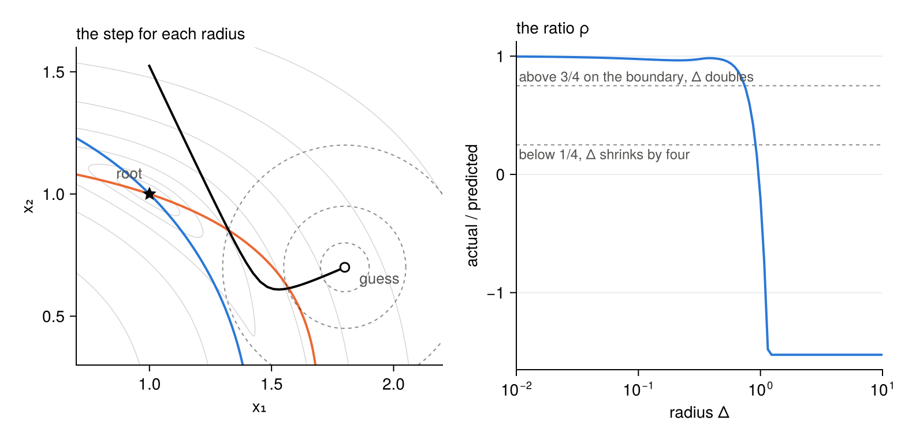

One step on a given radius can be seen by fixing the radius with `Δmax` and accepting every trial
with `eta=-Inf`.

```julia
x = [1.8, 0.7]
nkroot!(two!, x; jacobian=:ad, Δ=0.25, Δmax=0.25, eta=-Inf, maxiter=1, verbose=false)
```

With `trust=:classical`, the default, the radius moves after each trial according to its ratio.

| ratio | the trial | the radius |
|---|---|---|
| ρ ≤ `eta` | rejected, a shorter hookstep is tried | Δ/4 |
| `eta` < ρ < 1/4 | accepted | Δ/4 |
| 1/4 ≤ ρ ≤ 3/4 | accepted | unchanged |
| ρ > 3/4, on the boundary | accepted | min(2Δ, `Δmax`) |
| ρ > 3/4, inside | accepted | unchanged |

It spends one residual per iteration when the first trial is accepted. Three keywords shape it. `Δ`
is the first radius, and a small one spends iterations while the radius doubles. `Δmax` is the
largest radius, and a small cap forces short steps throughout. `eta` is the smallest ratio for a
step to be accepted. The lower row of the figure shows each on the two equations, from `(2.5, 2)`
for `Δ` and `Δmax` and from `(1.8, 0.7)` with `Δ=0.9` for `eta`, with `tol=1e-12` and dual numbers.

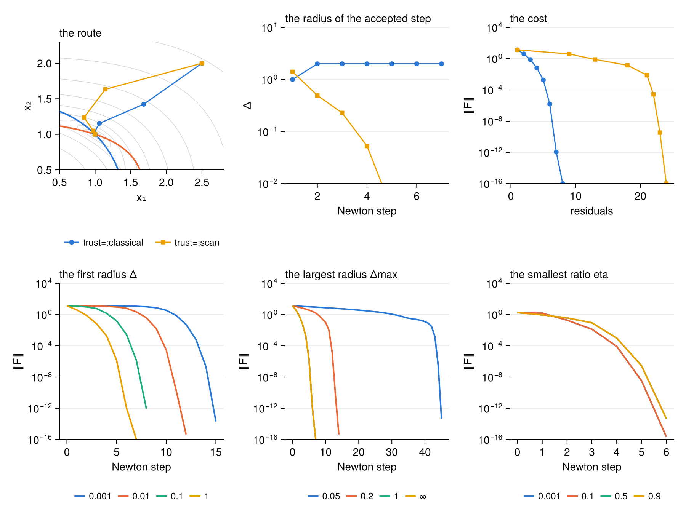

On the test problem the classical rule converges in 21 iterations.

```julia
nkroot!(bratu!, guess(); Δ=1.0, settings...)
# (status = :converged, iter = 21, res = 1.6440964169558804e-10)
```

Scripts: [`examples/hookstep/hookstep.jl`](examples/hookstep/hookstep.jl),
[`examples/update_rules/update_rules.jl`](examples/update_rules/update_rules.jl).

### The scan rules

With `trust=:scan` the radius is chosen among several trials of the same iteration, in the same
Krylov space. The next radius is the length of the step that was kept.

With `scan=:greedy`, the default scan, the hooksteps at the thirteen radii $\Delta\,2^{j/2}$,
$j = -6, \dots, 6$, are all tried, from $\Delta/8$ to $8\Delta$. Radii above `Δmax` or above the
length of the GMRES step give the same step and are tried once. Among the trials with ρ > `eta` the
one of smallest residual is kept. It lowers the residual the most at each iteration, at up to
thirteen residuals. It pays when a residual is cheap against a Krylov space. On the test problem it
takes the fewest iterations and the fewest products among the plain rules.

```julia
nkroot!(bratu!, guess(); Δ=1.0, trust=:scan, scan=:greedy, settings...)
# (status = :converged, iter = 12, res = 1.5699714843923932e-10)
```

With `scan=:longest` the search keeps the largest radius whose step is still accepted, ρ > `eta`.
It doubles the radius while trials are accepted, or halves it while they are rejected, and then
bisects in $\log\Delta$ until the largest accepted and the smallest rejected radius are within a
factor $\sqrt2$. This takes a few residuals per iteration. The longest step may lower the residual
less than a shorter one. The idea is that of the delayed gratification of Transtrum, Machta and
Sethna [6], who observe for the Levenberg–Marquardt method that, in a narrow curved canyon, the
longest step that still descends gains little at first and reaches the solution in fewer steps.

```julia
nkroot!(bratu!, guess(); Δ=1.0, trust=:scan, scan=:longest, settings...)
# (status = :converged, iter = 40, res = 2.9299031423172054e-10)
```

On the test problem the longest step is the slowest of the rules. It is made for a different
landscape, a narrow valley that bends. The two equations

```julia
function valley!(out, x)
    s      = x[2] - x[1]^2
    out[1] = s
    out[2] = s - 1e-3*x[1]
    return out
end
```

have one root, at the origin, at the vertex of a valley along the parabola $x_2 = x_1^2$. The
valley is a thousandth wide. Along its floor the linear model sees a straight valley, and a long
straight step leaves the true one. From `(-1, 1.1)`, with `Δ=1`, `tol=1e-12`, `maxiter=500` and dual
numbers, the three rules behave as follows.

| rule | iterations | residuals |
|---|---:|---:|
| `trust=:classical` | 210 | 242 |
| `trust=:scan, scan=:greedy` | 310 | 3977 |
| `trust=:scan, scan=:longest` | 11 | 20 |

```julia
x = [-1.0, 1.1]
nkroot!(valley!, x; jacobian=:ad, Δ=1.0, tol=1e-12, maxiter=500, trust=:scan, scan=:longest, verbose=false)
# (status = :converged, iter = 11, res = 1.895230234692832e-15)
```

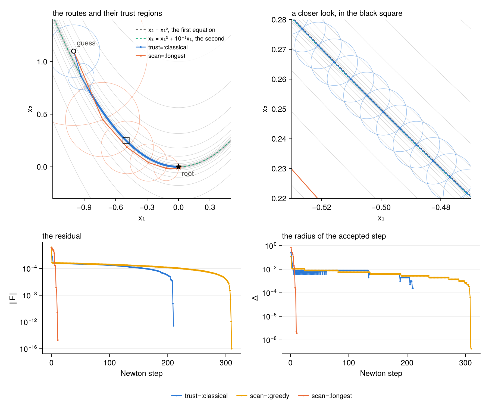

The circles are the trust regions of the accepted steps. The classical rule and the greedy scan
drop to the floor of the valley and then follow it in steps shorter than a hundredth. The longest
step stays above the floor and crosses the valley in a few steps longer than a tenth.

Script: [`examples/longest/longest.jl`](examples/longest/longest.jl).

### Geodesic acceleration

With `acceleration=:geodesic` every hookstep on the boundary of the trust region gets a
second-order correction, following Transtrum and Sethna [7]. The hookstep $v$, the velocity, comes
from the linear model. The acceleration $a$ solves the same damped problem with the second
directional derivative $F''[v, v]$ in place of the residual, and the step is

$$\delta x = v + \tfrac12 a, \qquad (J^{\mathsf T}J + \mu I)\,a = -J^{\mathsf T}F''[v, v],$$

with $\mu$ the multiplier of the hookstep. The correction bends the step with the valley. The
second derivative comes from one more residual, by a finite difference along $v$, and the
acceleration is solved in the Krylov space of the hookstep, with no product with the Jacobian. An
accelerated trial therefore costs two residuals. A trial whose acceleration is longer than `alpha`
times its velocity is rejected, with `alpha=0.75` by default. The trust region bounds the velocity,
so an accelerated step can be longer than `Δ`. The GMRES step inside the trust region is not
accelerated. It works with either rule of the radius, and needs the hookstep.

```julia
x = [-1.0, 1.1]
nkroot!(valley!, x; jacobian=:ad, Δ=1.0, tol=1e-12, maxiter=500, acceleration=:geodesic, verbose=false)
# (status = :converged, iter = 10, res = 2.0335292147031247e-15)
```

On the valley of the last subsection the classical rule takes 10 iterations with the acceleration
in place of 210. These two equations are quadratic, so the second derivative is the same everywhere
and its finite difference is exact. With the scan of the longest step the acceleration takes 8
iterations in place of 11.

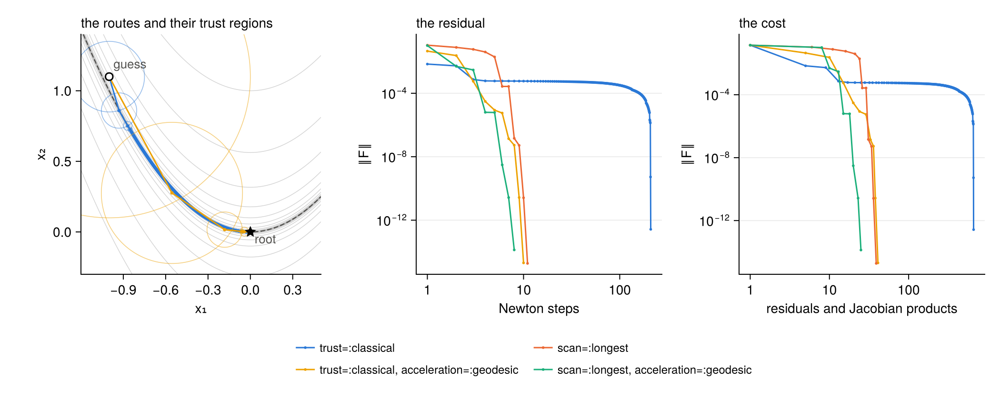

The settings are those of the last subsection. The circles are the trust regions of the accepted
steps. The middle panel shows the residual against the iterations, and the right one against the
residuals and Jacobian products evaluated.

On the Bratu test problem the gain is smaller, 18 iterations in place of 21 with the classical rule
and 13 in place of 40 with the longest step.

```julia
nkroot!(bratu!, guess(); Δ=1.0, acceleration=:geodesic, settings...)
# (status = :converged, iter = 18, res = 1.9796876435530597e-10)

nkroot!(bratu!, guess(); Δ=1.0, trust=:scan, scan=:longest, acceleration=:geodesic, settings...)
# (status = :converged, iter = 13, res = 1.842140886476726e-10)
```

Script: [`examples/geodesic/geodesic.jl`](examples/geodesic/geodesic.jl).

### Which one

The examples of this section suggest the following, and no more than that.

- The hookstep with the classical rule is the default because it converged from every guess of the
  test problem at about one residual per iteration.
- Classical Newton and backtracking are the cheapest where they converge. They converged from half
  of the guesses of the test problem.
- The greedy scan trades residuals for iterations. It suits a cheap residual and an expensive
  Krylov space.
- The longest step and the geodesic acceleration are for narrow curved valleys, where the classical
  rule takes many short steps.

The searches for [equilibria of Kolmogorov flow](#equilibria-of-kolmogorov-flow) compare the rules on
another problem, from a hundred guesses. There backtracking converges from 11 and the five rules of
the hookstep from 32 to 45, and the paired counts separate backtracking from the hookstep but do not
rank the five rules of the hookstep.

## Preconditioning

GMRES needs many Arnoldi steps when the Jacobian has a wide spectrum, and a preconditioner
$M \approx J$ with a cheap inverse reduces them [3]. The preconditioning is on the right. The
Arnoldi iteration runs on $JM^{-1}$ and the step is $\delta x = M^{-1}\,Q y$, with $Q y$ the
combination of Krylov vectors that GMRES or the hookstep chooses. Two properties follow.

- The residual of the Newton system is the true one, so `krylov_tol` keeps its meaning.
- The trust region bounds the step $\delta x$ itself, not its Krylov coordinates. The radius `Δ`,
  the length `‖δx‖` and the fraction `λ` are lengths in `x`, with or without a preconditioner.

The second needs the lengths of the vectors $M^{-1}q_j$, which the solver gets in one of three
ways, described [below](#the-length-of-the-step-and-gram).

### A fixed preconditioner

A preconditioner is any object `M` with `ldiv!(out, M, v)`, which writes $M^{-1}v$ into `out`. A
factorisation from LinearAlgebra is one. On the Bratu problem from zero, the LU factorisation of
the second differences removes the stiff part of the Jacobian, which is $A + \mathrm{diag}(e^u)$.

```julia
u = zeros(n)
nkroot!(bratu!, u; krylov_dim=250, Δ=1.0, krylov_tol=1e-6, tol=1e-8, verbose=false)   # 598 Jacobian products

u = zeros(n)
nkroot!(bratu!, u; precond=lu(A), Δ=1.0, krylov_tol=1e-6, tol=1e-8, verbose=false)    # 12 Jacobian products
```

Both searches take four iterations and find the same solution. The left panel of the figure below
shows GMRES on the first Newton system. Without the preconditioner the residual stays near one until
the space has a hundred vectors, half the size of the system. With it three vectors are enough.

### A preconditioner that follows the point

A preconditioner that depends on the point defines `NKRoots.update!(M, x)`. The search calls it
once per Newton iteration, after the update of the Jacobian. The default does nothing.

The example is a nonlinear diffusion, $(a(u)\,u')' + 1 = 0$ with $a = \nu + u^2$ and
$u(0) = u(1) = 0$, on 60 points with $\nu = 10^{-2}$. Its stiff part is the diffusion operator with
the diffusivity of the current point, which is tridiagonal and cheap to factorise.

```julia
N = 60
d = 1/(N + 1)
ν = 1e-2

# u at the point i, and the diffusivity between the points i and i + 1
at(u, i)          = 1 <= i <= N ? u[i] : zero(u[1])
diffusivity(u, i) = ν + (at(u, i) + at(u, i + 1))^2/4

function diffusion!(out, u)
    for i in 1:N
        right  = diffusivity(u, i)*(at(u, i + 1) - at(u, i))/d
        left   = diffusivity(u, i - 1)*(at(u, i) - at(u, i - 1))/d
        out[i] = (right - left)/d + 1
    end
    return out
end

# the operator with the diffusivity frozen at u
function operator(u)
    a = [diffusivity(u, i)/d^2 for i in 0:N]
    return Tridiagonal(a[2:N], -(a[1:N] .+ a[2:N + 1]), a[2:N])
end

mutable struct Diffusion
    F::Any # LU factorisation of the operator at the last point
end

NKRoots.update!(M::Diffusion, x)          = (M.F = lu(operator(x)); M)
LinearAlgebra.ldiv!(out, M::Diffusion, v) = ldiv!(out, M.F, v)

options = (Δ=1.0, krylov_tol=1e-6, krylov_dim=120, tol=1e-8, maxiter=100, verbose=false)

nkroot!(diffusion!, fill(1.0, N); options...)                                      # no preconditioner
nkroot!(diffusion!, fill(1.0, N); precond=lu(operator(fill(1.0, N))), options...)  # frozen at the guess
nkroot!(diffusion!, fill(1.0, N); precond=Diffusion(nothing), options...)          # moved by update!
```

```
   no preconditioner    converged  7 steps,  210 Jacobian products
   frozen at the guess  converged  7 steps,   82 Jacobian products
   moved by update!     converged  7 steps,   46 Jacobian products
```

The three searches take the same seven iterations, since GMRES solves to the same tolerance. The
frozen operator loses accuracy as the point moves away from the guess, and the moving one does not.

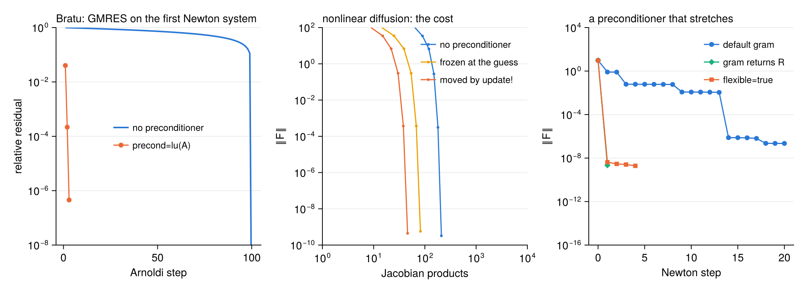

### The length of the step and `gram`

The step is $\delta x = \sum_j y_j\,z_j$ with $z_j = M^{-1}q_j$, so its length is

$$\lVert\delta x\rVert^2 = y^{\mathsf T} G\, y, \qquad G_{ij} = z_i \cdot z_j .$$

The solver asks the preconditioner for the Gram matrix $G$ through `NKRoots.gram(M, Q)`, once per
Newton iteration. The default applies $M^{-1}$ to each Krylov vector and takes the inner products,
which works for any preconditioner at the cost of one application per vector. A preconditioner that
can do better defines its own method. For a diagonal $M$ the Gram matrix is a weighted inner product
of the Krylov vectors themselves.

```julia
function broyden!(out, x)
    m = length(x)
    for i in 1:m
        out[i] = (3 - 2x[i])*x[i] + 1 - (i > 1 ? x[i - 1] : 0.0) - 2*(i < m ? x[i + 1] : 0.0)
    end
    return out
end

# the diagonal of the Jacobian, 3 - 4xᵢ, as preconditioner
struct Jacobi
    d::Vector{Float64} # the diagonal at the last point
end

NKRoots.update!(M::Jacobi, x)          = (M.d .= 3 .- 4 .* x; M)
LinearAlgebra.ldiv!(out, M::Jacobi, v) = (out .= v ./ M.d; out)

function NKRoots.gram(M::Jacobi, Q)
    w = 1 ./ M.d.^2
    return [sum(w .* Q[i] .* Q[j]) for i in eachindex(Q), j in eachindex(Q)]
end

x = fill(-1.0, 50)
nkroot!(broyden!, x; precond=Jacobi(zeros(50)), Δ=0.1, krylov_tol=1e-6, tol=1e-10, maxiter=50, verbose=false)
```

The script runs this search, on the Broyden tridiagonal function with 50 unknowns, with the default
`gram` and with this one. The residuals agree to $5\times10^{-10}$, and the applications of
$M^{-1}$ fall by the number of Krylov vectors.

```
   default gram       8 steps,  97 Jacobian products, 202 applications of M⁻¹, 8 calls of gram
   gram of your own   8 steps,  97 Jacobian products, 105 applications of M⁻¹, 8 calls of gram
```

`gram` may return the matrix $G$, or an `UpperTriangular` factor $R$ with $R^{\mathsf T}R = G$. The
second form matters for the preconditioners of the next subsection.

### Flexible GMRES

A Gram matrix holds the squares of the lengths of the vectors $z_j$. When $M^{-1}$ stretches a few
directions by a large factor, as a preconditioner that solves a few slow directions exactly does,
the long vectors hide the short ones in $G$. A spread of $10^{7}$ in length is a spread of
$10^{14}$ in $G$, close to the sixteen digits of double precision. The directions lost in this way
are missing from the step.

With `flexible=true` the solver keeps the vectors $z_j$ as the Arnoldi iteration makes them, as in
the flexible GMRES of Saad [4], and orthonormalises them one by one. The triangular factor $R$ of
this orthonormalisation gives the length, $\lVert\delta x\rVert = \lVert R y\rVert$, without ever
squaring the lengths. The price is one more stored vector per Krylov dimension. `gram` is not
called. A `gram` of your own that returns $R$ computed from the vectors, not from $G$, keeps the
short vectors as well.

The example is a linear system of 60 unknowns with one eigenvalue of $10^{-7}$ and the others
between 1 and 3, and a preconditioner that is exact on the slow direction and the identity on the
rest.

```julia
using Random

Random.seed!(1)
Q₀   = Matrix(qr(randn(60, 60)).Q)
B    = Q₀ * Diagonal([1e-7; range(1, 3; length=59)]) * Q₀'
c    = randn(60)
slow = Q₀[:, 1]

struct Slow
    v::Vector{Float64} # the slow direction
    μ::Float64         # its eigenvalue
end

LinearAlgebra.ldiv!(out, M::Slow, q) = (out .= q .+ (1/M.μ - 1)*dot(M.v, q) .* M.v; out)

linear!(out, x) = (mul!(out, B, x); out .-= c; out)

x = zeros(60)
nkroot!(linear!, B, x; precond=Slow(slow, 1e-7), flexible=true, Δ=1e8, krylov_dim=40, krylov_tol=1e-10,
        tol=1e-12, maxiter=20, verbose=false)
```

The script runs it with the default `gram`, with a `gram` that returns $R$ from a QR factorisation
of the vectors, and with `flexible=true`.

```
   default gram, a Gram matrix  ‖F‖ = 8.2e-01 after one step, 2.2e-07 after 20
   gram returns the root R      ‖F‖ = 2.2e-09 after one step, 2.2e-09 after 1
   flexible=true                ‖F‖ = 4.2e-09 after one step, 1.9e-09 after 4
```

The problem is linear, so one Newton step should solve it. With the root or with flexible GMRES it
does, down to the rounding of the residual. That floor is near $10^{-9}$ here, because the solution
has a component of order $10^{7}$ along the slow direction, and no search reaches `tol=1e-12`. With
the Gram matrix the first step leaves most of the residual, and twenty steps do not reach the floor.
The right panel of the figure above shows the three searches.

Script: [`examples/preconditioner/preconditioner.jl`](examples/preconditioner/preconditioner.jl).

## Tracing and callbacks

### The trace

A `Trace` is a callback that records the search. Pass it as `callback`, and read its fields
afterwards. `Trace(keep=true)` also keeps a copy of every iterate.

```julia
trace = Trace(keep=true)
u     = [20*sin(π*i*h) for i in 1:n]
nkroot!(bratu!, u; precond=lu(A), Δ=20.0, krylov_tol=1e-6, tol=1e-9, maxiter=60, verbose=false, callback=trace)

trace
```

Printed, it is a table with one row per record, here with a finite-difference Jacobian and
`krylov_dim=50`. Iterations 2 to 8 are cut from the listing.

```
Trace with 33 records
╭──────┬────────────┬───────────┬───────────┬───────────┬─────────┬───────┬──────────┬──────┬─────────╮
│ iter │        ‖F‖ │      ‖δx‖ │         Δ │         λ │       ρ │ dim K │ products │ rej. │    time │
├──────┼────────────┼───────────┼───────────┼───────────┼─────────┼───────┼──────────┼──────┼─────────┤
│    0 │ 2.4470e+09 │           │  2.00e+01 │           │         │       │        0 │      │     0.0 │
│    1 │ 9.0019e+08 │  1.25e+01 │  2.00e+01 │  1.00e+00 │   0.865 │    50 │       50 │    0 │     0.0 │
│    … │            │           │           │           │         │       │          │      │         │
│    9 │ 3.0144e+05 │  1.07e+01 │  2.00e+01 │  1.00e+00 │   0.865 │    50 │      450 │    0 │     0.0 │
│   10 │ 1.6132e+05 │  2.00e+01 │  2.00e+01 │  9.15e-01 │   0.714 │    43 │      493 │    0 │     0.0 │
│   11 │ 1.1416e+05 │  2.00e+01 │  2.00e+01 │  6.94e-01 │   0.499 │    29 │      522 │    0 │     0.0 │
│   12 │ 4.9521e+04 │  5.00e+00 │  5.00e+00 │  2.32e-02 │   0.926 │    26 │      548 │    1 │     0.0 │
│   13 │ 3.0386e+04 │  1.00e+01 │  1.00e+01 │  1.13e-01 │   0.628 │    23 │      571 │    0 │     0.0 │
│   14 │ 1.3704e+04 │  1.00e+01 │  1.00e+01 │  2.94e-02 │   0.798 │    20 │      591 │    0 │     0.0 │
│   15 │ 1.0941e+04 │  2.00e+01 │  2.00e+01 │  8.99e-01 │   0.363 │    16 │      607 │    0 │     0.0 │
│   16 │ 5.4005e+03 │  5.00e+00 │  5.00e+00 │  1.56e-01 │   0.940 │    17 │      624 │    1 │     0.0 │
│   17 │ 3.6512e+03 │  1.00e+01 │  1.00e+01 │  5.18e-02 │   0.661 │    16 │      640 │    0 │     0.0 │
│   18 │ 1.9720e+03 │  1.00e+01 │  1.00e+01 │  3.56e-01 │   0.890 │    13 │      653 │    0 │     0.0 │
│   19 │ 1.6050e+03 │  2.00e+01 │  2.00e+01 │  7.30e-01 │   0.351 │    12 │      665 │    0 │     0.0 │
│   20 │ 1.4298e+03 │  5.00e+00 │  5.00e+00 │  4.04e-02 │   0.929 │    11 │      676 │    1 │     0.0 │
│   21 │ 1.3978e+03 │  1.00e+01 │  1.00e+01 │  7.99e-02 │   0.270 │    10 │      686 │    0 │     0.0 │
│   22 │ 1.2701e+03 │  2.50e+00 │  2.50e+00 │  1.60e-03 │   1.029 │    11 │      697 │    1 │     0.0 │
│   23 │ 1.1602e+03 │  5.00e+00 │  5.00e+00 │  5.05e-02 │   1.224 │    10 │      707 │    0 │     0.0 │
│   24 │ 9.1658e+02 │  1.00e+01 │  1.00e+01 │  1.63e-01 │   1.003 │     9 │      716 │    0 │     0.0 │
│   25 │ 6.6884e+02 │  1.95e+01 │  2.00e+01 │  1.00e+00 │   0.468 │     9 │      725 │    0 │     0.0 │
│   26 │ 4.2224e+02 │  1.20e+01 │  2.00e+01 │  1.00e+00 │   0.601 │     8 │      733 │    0 │     0.0 │
│   27 │ 1.3502e+02 │  5.00e+00 │  5.00e+00 │  3.02e-01 │   0.924 │     8 │      741 │    1 │     0.0 │
│   28 │ 1.8391e+01 │  2.54e+00 │  1.00e+01 │  1.00e+00 │   0.981 │     7 │      748 │    0 │     0.0 │
│   29 │ 5.7483e-01 │  5.34e-01 │  1.00e+01 │  1.00e+00 │   0.999 │     6 │      754 │    0 │     0.0 │
│   30 │ 7.4178e-04 │  1.89e-02 │  1.00e+01 │  1.00e+00 │   1.000 │     6 │      760 │    0 │     0.0 │
│   31 │ 5.4178e-09 │  2.43e-05 │  1.00e+01 │  1.00e+00 │   1.000 │     6 │      766 │    0 │     0.0 │
│   32 │ 1.8228e-10 │  3.68e-11 │  1.00e+01 │  1.00e+00 │   0.999 │     6 │      772 │    0 │     0.0 │
╰──────┴────────────┴───────────┴───────────┴───────────┴─────────┴───────┴──────────┴──────┴─────────╯
```

In this table `Δ` is the radius with which the accepted step was computed, the field `radius`,
where the table of `nkroot!` prints the radius for the next iteration.

Every field is a vector with one entry per record. The first record is the guess, and the others
follow the iterations.

| field | what it records |
|---|---|
| `iter` | the iteration number |
| `time` | the seconds elapsed since the first record |
| `res` | the residual norm $\lVert F\rVert$ |
| `residuals` | evaluations of the residual by the search, cumulative |
| `products` | products with the Jacobian, cumulative |
| `preconditioner` | applications of $M^{-1}$, cumulative |
| `jacobian_updates` | calls of `update!(J, x, r)`, cumulative |
| `preconditioner_updates` | calls of `update!(M, x)`, cumulative |
| `grams` | calls of `gram`, cumulative |
| `function_calls` | calls of `F!`, cumulative, by the search and by a Jacobian built by NKRoots.jl. The calls inside a Jacobian of your own are not seen |
| `krylov` | the relative residual of GMRES after each Arnoldi step of the iteration, a vector. Empty at the start |
| `step` | the kind of the accepted step, `"newton"`, `"hook"` or `"line"`. Empty at the start |
| `steplength` | the length $\lVert\delta x\rVert$ of the accepted step, in the `norm` of the vectors, also with a preconditioner. `NaN` at the start |
| `fraction` | the length of the accepted step over that of the GMRES step of the iteration. One for a `"newton"` step, the factor of backtracking for a `"line"` step. `NaN` at the start |
| `radius` | the trust-region radius with which the accepted step was computed. A `"newton"` step is shorter than its radius, a `"hook"` step is as long. Without a trust region it is the length of the step again. At the start it is the first radius `Δ` |
| `ratio` | the actual over the predicted reduction of $\lVert F\rVert^2$ of the accepted step. `NaN` at the start |
| `trials` | the other trials of the iteration, in the order they were made, each as the pair of its radius and its ratio |
| `rejected` | the number of those trials with a ratio not above `eta` |
| `globalisation` | the keyword `globalisation` of the search |
| `x` | a copy of the iterate, with `keep=true` |

Three remarks on these fields.

- With the geodesic acceleration `steplength` and `fraction` are those of the whole step,
  $v + a/2$, and `radius` bounds the velocity $v$. So `steplength` can exceed `radius`, and a
  `"hook"` step can have a `fraction` above one.
- With backtracking the trials are the steps refused before the accepted one, each half as long as
  the one before, with its length as radius. `fraction` is then `2.0^-length(trials)`, unless
  `Δmax` has capped the first trial. `rejected` is `length(trials)`, as it is with
  `trust=:classical`. With `trust=:scan` some trials are good steps that were not kept, and
  `rejected` is smaller.
- The same trace can follow several calls of `nkroot!`. The iteration numbers start again from zero
  with each call.

One record of the search above, and the counts at its end, read

```
record 13, iteration 12
  step       = hook
  radius     = 5.0
  steplength = 4.999999999999233
  ratio      = 0.9257769374577011
  trials     = [(20.0, -1.0483802173663836)]
  rejected   = 1
  krylov     = 26 Arnoldi steps, down to 2.793155963582246e-7
counts at the end
  residuals              = 38
  products               = 772
  preconditioner         = 1581
  jacobian_updates       = 32
  preconditioner_updates = 32
  grams                  = 32
  function_calls         = 810
```

At iteration 12 the trial on the radius 20 raised the residual, with a negative ratio, and the
hookstep on the radius 5 was accepted. The calls of `F!` are the 38 residuals and one per product
of the finite-difference Jacobian.

The figure plots the fields of this trace. The search starts far above the solution. For nine
iterations the Krylov space reaches its cap of 50 vectors, and the GMRES step of that space is
shorter than the radius. Then come hooksteps, some after a rejected trial, and at the end Newton
steps with the quadratic fall of the residual. The last panel shows the iterates, light to dark.

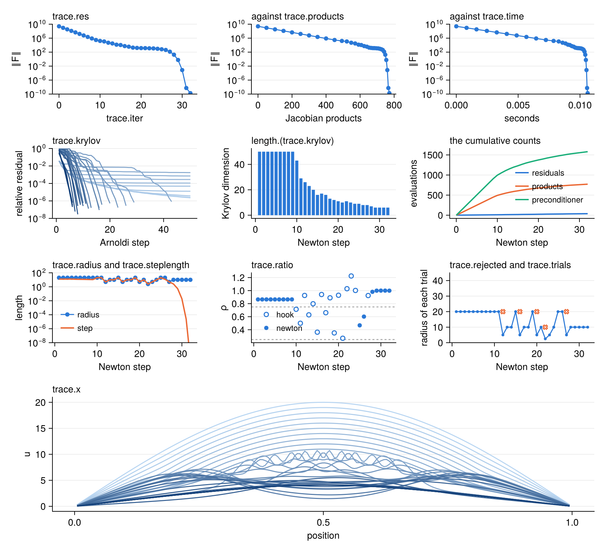

### Callbacks

A callback is any function of one argument. It is called once at the start and once after every
iteration, with a named tuple `info`, and it stops the search by returning `true`.

| `info.` | |
|---|---|
| `iter`, `x`, `res` | the iteration, the current point (not a copy) and the residual norm |
| `evaluations` | a named tuple of the cumulative counts, `residuals`, `products`, `preconditioner`, `jacobian_updates`, `preconditioner_updates`, `grams` and `function_calls` |
| `krylov`, `step`, `radius`, `steplength`, `fraction`, `ratio`, `rejected`, `trials`, `globalisation` | as the fields of `Trace` |

To record and stop in the same search, call the trace inside the callback. The table can go to a
file with `io`, or be silenced with `verbose=false`.

```julia
record = Trace()
stop   = info -> (record(info); info.res < 1e-3 || info.iter >= 15)

u    = zeros(n)
file = tempname()
out  = open(file, "w") do io
    nkroot!(bratu!, u; precond=lu(A), Δ=1.0, tol=1e-10, maxiter=20, io=io, callback=stop)
end
# (status = :stopped, iter = 3, res = 4.5389194259088743e-7)
```

The last line of the file is `■ stopped by the callback: 3 steps, ‖F‖ = 4.539e-07, 4 residuals, 6 Jacobian products`.

Script: [`examples/tracing/tracing.jl`](examples/tracing/tracing.jl).

## Examples

Two problems from fluid dynamics, each with a preconditioner taken from its stiff linear part,
the diffusion in the first and the Stokes operator in the second.

### The turbulent channel

The mean flow of a turbulent channel with the model of Spalart and Allmaras [24]. It has two
coupled fields, a strong nonlinearity and a stiff operator, and it uses a preconditioner that
follows the point.

In units of the half height and of the friction velocity, with $\nu = 1/Re_\tau$, on
$0 \le y \le 1$, the streamwise momentum balance and the transport of the working variable
$\tilde\nu$ are

$$\frac{d}{dy}\Big[(\nu + \nu_t)\frac{dU}{dy}\Big] + 1 = 0,$$

$$\underbrace{c_{b1}\tilde S\tilde\nu}_{\text{production}}
- \underbrace{c_{w1}f_w\Big(\frac{\tilde\nu}{y}\Big)^2}_{\text{destruction}}
+ \underbrace{\frac{1}{\sigma}\frac{d}{dy}\Big[(\nu + \tilde\nu)\frac{d\tilde\nu}{dy}\Big]
+ \frac{c_{b2}}{\sigma}\Big(\frac{d\tilde\nu}{dy}\Big)^2}_{\text{diffusion}} = 0,$$

with $U = \tilde\nu = 0$ at the wall and zero gradients at the centre. The closures, written out in
the header of the script, give $\nu_t$, $\tilde S$ and $f_w$ as functions of $\tilde\nu$, $dU/dy$
and $y$. The derivatives are the fourth-order finite differences of
[FDGrids.jl](https://github.com/Davide-Lasagna-s-Lab/FDGrids.jl), with five-point stencils on 300
points stretched towards the wall. The unknown holds the two fields, `[U; ν̃]`, and the Jacobian is
by dual numbers.

Both equations hold the same operator,

$$\mathcal D_a = \frac{d}{dy}\,a\,\frac{d}{dy} = a\frac{d^2}{dy^2} + \frac{da}{dy}\frac{d}{dy},$$

with $a = \nu + \nu_t$ for the velocity and $a = (\nu + \tilde\nu)/\sigma$ for $\tilde\nu$. It is
the stiff term, for two reasons. The first is its size. The first spacing at the wall is
$h \approx 10^{-4}$, so the second derivative has entries of order $a/h^2$, about $10^5$ at
$Re_\tau = 1000$, and production and destruction hold no second derivative. The second is its
reach. A row of the matrix couples a point to two neighbours on each side, so one product with the
Jacobian moves information by two points, and the wall is 300 points from the centre.

A direct solve of the diffusion removes both, so it is the preconditioner,

$$M = \begin{pmatrix} \mathcal D_{\nu + \nu_t} & 0 \\ 0 & \mathcal D_{(\nu + \tilde\nu)/\sigma} \end{pmatrix}.$$

Its coefficients depend on the point, so `update!(M, x)` factorises the two blocks again at each
Newton iteration.

The search goes up in the Reynolds number, and each solution is the guess of the next. The six
values 180, 300, 550, 1000, 2000 and 5200 take between 16 and 58 iterations each, with `Δ=1`,
`krylov_dim=300`, `krylov_tol=1e-3`, `tol=1e-8` and `maxiter=100`. The table compares three
preconditioners on one step of the continuation, from the solution at 550 to the one at 1000, with
`maxiter=40`.

| preconditioner | Jacobian products | outcome |
|---|---:|---|
| none | 12000 | $\lVert F\rVert = 1.2$ after 40 iterations |
| the Laplacian $\nu\,d^2/dy^2$ on both fields, factorised once | 1909 | converged in 29 iterations |
| the diffusion, factorised at each iteration | 385 | converged in 28 iterations |

The two preconditioners take about the same iterations, since GMRES solves to the same tolerance.
The diffusion needs a fifth of the products, about 14 per iteration. The Laplacian has the form of
the diffusion but not its coefficient, because the eddy viscosity away from the wall is far larger
than the viscosity.

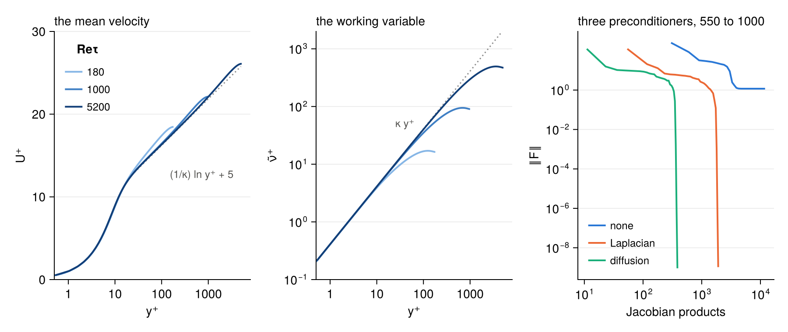

The left and middle panels show the solutions at three Reynolds numbers, with the logarithmic law
and the line $\tilde\nu^+ = \kappa y^+$ for reference. The momentum equation integrates to
$(\nu + \nu_t)\,dU/dy = 1 - y$, which checks the solution. The error of this balance at
$Re_\tau = 1000$ falls with the fourth power of the spacing, the order of the stencils.

| points | error of the total stress | order |
|---:|---:|---:|
| 150 | $6.90\times 10^{-5}$ | |
| 300 | $4.32\times 10^{-6}$ | 4.00 |
| 600 | $2.70\times 10^{-7}$ | 4.00 |

Script: [`examples/spalart_allmaras/spalart_allmaras.jl`](examples/spalart_allmaras/spalart_allmaras.jl).

### Equilibria of Kolmogorov flow

A two-dimensional flow, periodic on the square $[0, 2\pi)^2$ and driven by the force
$\sin(4y)\,\mathbf e_x$ at $Re = 40$, as in the catalogue of Golden [25]. With the vorticity
$\omega$, an equilibrium is a root of

$$N(\omega) = \mathbf u\cdot\nabla\omega - \frac{1}{Re}\nabla^2\omega + 4\cos(4y) = 0,$$

where the velocity $\mathbf u$ comes from $\omega$ through the streamfunction. The paper searches
travelling waves and equilibria together, with the wave speed as an unknown and a phase condition on
the Newton step. This example keeps to equilibria. The formulation is written out in
[`notes/kolmogorov/kolmogorov.pdf`](notes/kolmogorov/kolmogorov.pdf).

**The shift.** The forcing does not depend on $x$, so every shifted copy $\omega(x + s, y)$ of an
equilibrium is an equilibrium. The derivative of $N(\omega(x + s, y)) = 0$ in $s$ is
$N'(\omega)\,\partial_x\omega = 0$, so the Jacobian is singular there. The example removes the shift
by a symmetry. It searches among the fields that the rotation $(x, y) \to (-x, -y)$ leaves as they
are. Each term of $N$ keeps that symmetry. The forcing is even in $y$ and constant in $x$. The
Laplacian has two derivatives, whose signs cancel. In the advection the velocity and the gradient
each change sign, and their product does not. In this subspace $\partial_x\omega$ changes sign under
the rotation, so it is not a member, the Jacobian has lost that null vector, and a state cannot
drift. Every root is an equilibrium. Equilibria without the symmetry are not found.

**The discretisation.** The vorticity is on a grid of 128 × 128 points, with derivatives by the fast
Fourier transform and the two-thirds rule, $|k_x|, |k_y| \le 42$. The unknown is the matrix of the
values on the grid. The residual is

$$G(\omega) = \Pi\,N(\Pi\omega) + (I - \Pi)\,\omega,$$

where the projector $\Pi$ discards the modes beyond the rule, removes the mean and takes the real
part of every Fourier coefficient. The real part is the symmetric part of the field, because the
coefficient of the rotated field at $\mathbf k$ is the one at $-\mathbf k$, its conjugate. Outside
the range of $\Pi$ the residual is the identity, so the Newton step subtracts whatever rounding puts
there, and the iterates stay in the subspace.

**The preconditioner.** The stiff part is the viscous term, with eigenvalues from $1/Re$ to
$2\cdot42^2/Re = 88$ on the kept modes. The preconditioner is the Stokes operator
$-\nabla^2/Re$ on the range of $\Pi$ and the identity elsewhere. It is diagonal in Fourier space, so
`ldiv!` multiplies each kept coefficient by $Re/|\mathbf k|^2$, at the cost of two transforms. The
paper applies $Re\,\nabla^{-2}$ on the left of the Newton system and reports that it was critical
to the success of GMRES. Here the same operator acts on the right, so that the trust region stays
on the step in $\omega$.

```julia
include(joinpath(pkgdir(NKRoots), "examples", "kolmogorov", "problem.jl"))

K = Kolmogorov(128; Re=40)
G!(out, ω) = residual!(out, ω, K)

ω = guess(K, 4)
nkroot!(G!, ω; precond=Stokes(K), Δ=20.0, krylov_dim=200, krylov_tol=1e-2, tol=1e-8, maxiter=80)
```

`guess(K, seed)` is the guess of the paper made symmetric. It is random noise filtered at a
wavenumber of 4, 5 or 6, with zero mean and unit standard deviation. The norm of the solver is the
Euclidean norm of the values on the grid, 128 times the root mean square. The search of the block,
from the seed 4, converges in 19 iterations.

```
╭──────┬────────────┬───────────┬───────────┬───────────┬─────────┬───────┬────────────┬──────────┬──────╮
│ iter │        ‖F‖ │      ‖δx‖ │         Δ │         λ │       ρ │ dim K │ GMRES res. │     step │ rej. │
├──────┼────────────┼───────────┼───────────┼───────────┼─────────┼───────┼────────────┼──────────┼──────┤
│    0 │ 3.7871e+02 │           │  2.00e+01 │           │         │       │            │          │      │
│    1 │ 3.5780e+02 │  2.00e+01 │  4.00e+01 │  2.54e-02 │   0.956 │    38 │   9.39e-03 │   ↪ hook │    0 │
│    2 │ 3.2188e+02 │  4.00e+01 │  8.00e+01 │  5.52e-02 │   0.993 │    37 │   8.08e-03 │   ↪ hook │    0 │
│    3 │ 2.5399e+02 │  8.00e+01 │  1.60e+02 │  9.58e-02 │   1.090 │    40 │   9.43e-03 │   ↪ hook │    0 │
│    4 │ 1.5820e+02 │  1.60e+02 │  3.20e+02 │  1.77e-02 │   0.886 │    58 │   9.45e-03 │   ↪ hook │    0 │
│    5 │ 9.7336e+01 │  8.00e+01 │  1.60e+02 │  3.70e-03 │   1.031 │    89 │   8.08e-03 │   ↪ hook │    1 │
│    6 │ 6.9182e+01 │  4.00e+01 │  8.00e+01 │  8.83e-02 │   1.054 │    81 │   8.98e-03 │   ↪ hook │    1 │
│    7 │ 6.3234e+01 │  8.00e+01 │  2.00e+01 │  3.98e-01 │   0.228 │    73 │   1.00e-02 │   ↪ hook │    0 │
│    8 │ 4.3254e+01 │  2.00e+01 │  4.00e+01 │  4.41e-03 │   1.009 │    98 │   9.32e-03 │   ↪ hook │    0 │
│    9 │ 4.1014e+01 │  4.00e+01 │  4.00e+01 │  1.89e-02 │   0.361 │    95 │   8.62e-03 │   ↪ hook │    0 │
│   10 │ 3.6968e+01 │  4.00e+01 │  4.00e+01 │  1.78e-02 │   0.520 │    95 │   9.56e-03 │   ↪ hook │    0 │
│   11 │ 2.8915e+01 │  4.00e+01 │  4.00e+01 │  7.03e-02 │   0.676 │    95 │   8.76e-03 │   ↪ hook │    0 │
│   12 │ 2.6258e+01 │  4.00e+01 │  4.00e+01 │  1.67e-01 │   0.349 │    81 │   9.60e-03 │   ↪ hook │    0 │
│   13 │ 2.1775e+01 │  4.00e+01 │  4.00e+01 │  4.01e-01 │   0.424 │    77 │   8.65e-03 │   ↪ hook │    0 │
│   14 │ 9.2675e+00 │  3.43e+01 │  4.00e+01 │  1.00e+00 │   0.819 │    72 │   9.22e-03 │ → newton │    0 │
│   15 │ 2.6447e-01 │  5.32e+00 │  4.00e+01 │  1.00e+00 │   0.999 │    67 │   1.00e-02 │ → newton │    0 │
│   16 │ 2.4326e-03 │  1.99e-01 │  4.00e+01 │  1.00e+00 │   1.000 │    79 │   9.14e-03 │ → newton │    0 │
│   17 │ 2.2007e-05 │  3.82e-03 │  4.00e+01 │  1.00e+00 │   1.000 │    74 │   9.05e-03 │ → newton │    0 │
│   18 │ 2.0431e-07 │  2.14e-05 │  4.00e+01 │  1.00e+00 │   1.000 │    75 │   9.28e-03 │ → newton │    0 │
│   19 │ 1.9558e-09 │  8.53e-08 │  4.00e+01 │  1.00e+00 │   1.000 │    69 │   9.57e-03 │ → newton │    0 │
╰──────┴────────────┴───────────┴───────────┴───────────┴─────────┴───────┴────────────┴──────────┴──────╯
  ✓ converged: 19 steps, ‖F‖ = 1.956e-09, 22 residuals, 1393 Jacobian products
```

**The checks.** The laminar state $\omega = -(Re/4)\cos(4y)$ solves the equations, and the residual
there is $8\times10^{-12}$ in the norm of the grid. Multiplying $N(\omega) = 0$ by the
streamfunction and averaging over the square gives the energy balance of an equilibrium, $D = I$,
with the dissipation $D = \langle\omega^2\rangle/Re$ and the input
$I = \langle u\sin(4y)\rangle$. Every search below that converges satisfies it, with
$|D - I| \le 8.3\times10^{-13}$.

**The globalisations.** The script runs the guesses of the seeds 1 to 100 with backtracking and
with five rules of the hookstep, the classical rule of the radius, the greedy scan, the longest
scan, and the classical rule and the longest scan with the geodesic acceleration. The other
settings are those of the block above, the same for every search, with at most 80 iterations. The
cost is counted in calls of $G$. A product with the Jacobian by finite differences is one call of
$G$, so this counts the residuals of the trials and the products of the Krylov spaces alike, and it
is fair to the scans, which spend more residuals per iteration.

| rule | converge, of 100 | different equilibria | calls of $G$ of those that converge, median and range | the others | calls of $G$, all 100 searches |
|---|---:|---:|---|---|---:|
| `globalisation=:backtracking` | 11 | 11 | 1674, 833 to 3248 | 46 reach 80 iterations and 43 collapse, median $\lVert G\rVert$ 243 | 814 267 |
| `trust=:classical` | 45 | 34 | 1486, 833 to 8551 | reach 80 iterations, median $\lVert G\rVert$ 22.5 | 563 142 |
| `trust=:scan, scan=:greedy` | 42 | 32 | 1836, 978 to 8908 | reach 80 iterations, median $\lVert G\rVert$ 16.6 | 674 457 |
| `trust=:scan, scan=:longest` | 39 | 38 | 1582, 774 to 5650 | reach 80 iterations, median $\lVert G\rVert$ 22 | 589 360 |
| `trust=:classical, acceleration=:geodesic` | 44 | 31 | 1478, 928 to 3776 | reach 80 iterations, median $\lVert G\rVert$ 22.1 | 566 268 |
| `trust=:scan, scan=:longest, acceleration=:geodesic` | 32 | 29 | 1530, 757 to 3126 | reach 80 iterations, median $\lVert G\rVert$ 25.4 | 647 974 |

The guesses are the same for every rule, so two rules are compared on the guesses from which one
converges and the other does not. The table counts them, for the rule of the row against the rule of
the column.

| | (1) | (2) | (3) | (4) | (5) | (6) |
|---|---:|---:|---:|---:|---:|---:|
| (1) backtracking | | 7 | 6 | 6 | 8 | 8 |
| (2) classical | 41 | | 18 | 27 | 10 | 27 |
| (3) greedy scan | 37 | 15 | | 22 | 18 | 25 |
| (4) longest scan | 34 | 21 | 19 | | 21 | 25 |
| (5) classical, geodesic | 41 | 9 | 20 | 26 | | 24 |
| (6) longest scan, geodesic | 29 | 14 | 15 | 18 | 12 | |

If two rules were equally likely to converge from a guess, each of these guesses would favour one or
the other with probability one half. The two-sided sign test gives the probability $p$ of a split as
uneven as the one observed.

- **Backtracking** converges from fewer guesses than every rule of the hookstep. Against each of them
  the split is between 6 and 8 for backtracking and between 29 and 41 for the hookstep, with
  $p \le 7.5\times10^{-4}$. It spends 27 residuals per iteration, and 43 of its searches end as
  `:collapsed`.
- **The five rules of the hookstep** converge from 32 to 45 guesses, and the paired counts do not rank
  them. For every pair each rule converges from guesses where the other does not, 9 to 27 of them
  each way, and $p \ge 0.06$. The two most uneven splits set the longest scan with the acceleration
  against the classical rule, 14 against 27 with $p = 0.06$, and against the classical rule with the
  acceleration, 12 against 24 with $p = 0.065$. With a hundred guesses this is not enough to say that
  one rule converges more often than another.
- **The cost.** The searches that converge cost about the same with every rule of the hookstep, a
  median of 1478 to 1836 calls of $G$. The cost of all hundred searches is set by those that stall,
  which run to the cap of 80 iterations. It is lowest with the classical rule, 563 142 calls, and
  highest with the greedy scan among the rules of the hookstep, 674 457 calls, of which 10% are
  residuals. Both numbers depend on the cap.

The 213 searches that converge reach 111 different equilibria, and none of them is the laminar
state. The one found most often is reached 13 times, and 73 are reached once. From the same guess
two rules often reach different equilibria. Of the 59 guesses from which at least two rules converge,
49 lead to more than one equilibrium. No rule converges from 13 guesses.

The equilibria are told apart by their dissipation and energy. Within each group of searches these
two agree to $4\times10^{-11}$, relative, and so does the palinstrophy
$\langle|\nabla\omega|^2\rangle$, a third quantity that two different equilibria would have to share
as well to be confused. Two groups differ by at least $2.1\times10^{-3}$, relative, in the
dissipation or the energy, so the grouping does not depend on its tolerance of $10^{-6}$. Whether these equilibria are
among those of the catalogue of Golden is not checked here.

**GMRES and the preconditioner.** The script solves two Newton systems of the search from the seed
1 to a relative residual of $10^{-8}$, with and without the preconditioner, in a Krylov space of up
to 600 vectors. On the first system, at the guess, GMRES with the preconditioner needs 80 vectors,
and without it 600 vectors reach $10^{-3}$. On the last system, next to the equilibrium, it needs
182 vectors, and without it 600 vectors reach $0.1$. A search asks for $10^{-2}$ in at most 200
vectors, which GMRES without the preconditioner does not deliver. The search from the seed 1 without it
reaches 80 iterations at a residual of 52, after 16000 products, where the preconditioned one
converges after 8466. This agrees with the statement of the paper.

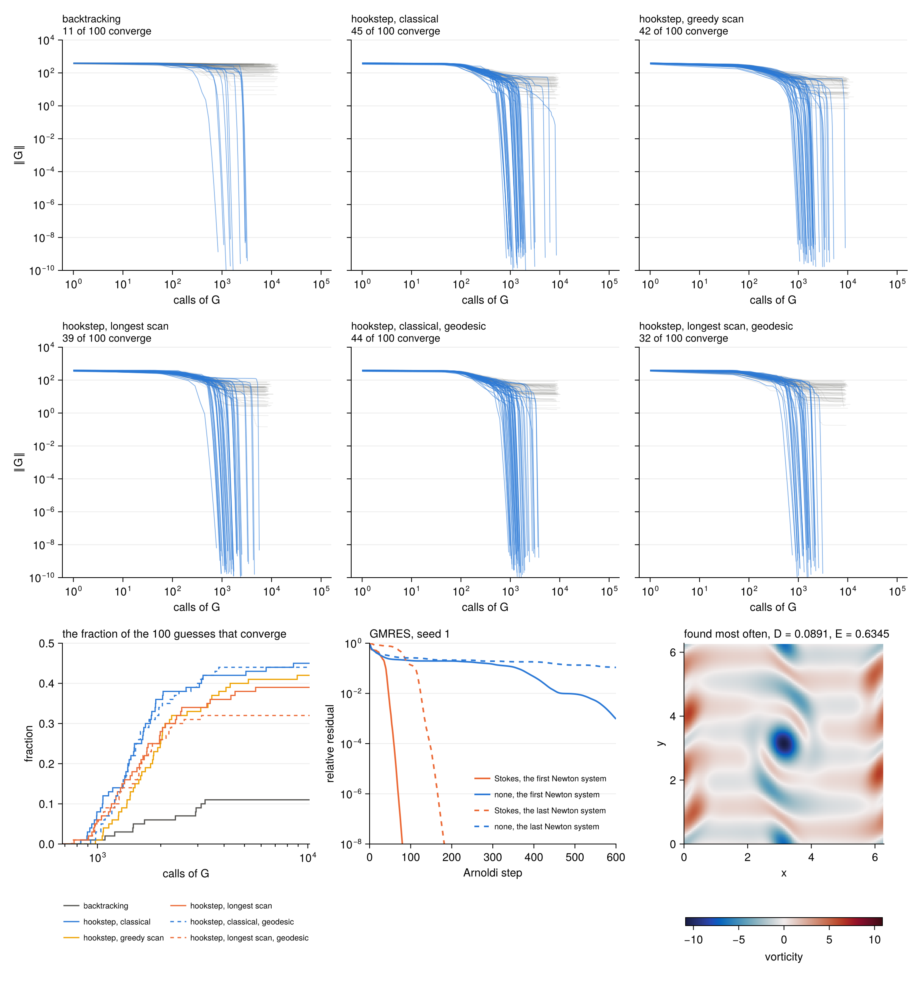

Top, one panel for each rule, with the residual of its hundred searches against their cost in
calls of $G$, blue for the searches that converge and grey for the others. Bottom left, the fraction
of the hundred guesses from which each rule has converged within a given cost, between the cheapest
and the dearest search that converges. Bottom middle, the relative residual of GMRES on the two
Newton systems. Bottom right, the vorticity of the equilibrium found most often, with its
dissipation $D$ and its kinetic energy $E = \langle|\mathbf u|^2\rangle/2$.

The example tests the solver on a problem from the literature. It is not a survey of the equilibria
of the flow.

Script: [`examples/kolmogorov/kolmogorov.jl`](examples/kolmogorov/kolmogorov.jl), with the
discretisation in [`examples/kolmogorov/problem.jl`](examples/kolmogorov/problem.jl). Every search is
listed in [`examples/kolmogorov/searches.csv`](examples/kolmogorov/searches.csv), with its rule, guess,
status, cost, dissipation, energy and equilibrium. The 600 searches run in parallel, one per thread,
each on a grid of its own that holds the work arrays of its residual and preconditioner.

```
julia -t 8 --project=examples examples/kolmogorov/kolmogorov.jl
```

A search does not depend on the number of threads, since the transforms and the dense algebra run
on one thread inside each search. The script sets that, because the number of threads of BLAS
changes the rounding of its sums, and over 80 iterations this can change how a search that stalls
ends. With 8 threads on a laptop of 4 performance and 6 efficiency
cores the script takes about fifty minutes.

## How it works

We look for $x \in \mathbb R^N$ with $F(x) = 0$, where $F : \mathbb R^N \to \mathbb R^N$ is
differentiable. Norms and inner products are those of the vectors, `norm` and `dot`. One Newton
iteration has two stages. The first builds a Krylov space, at one product with the Jacobian per
vector. The second tries steps inside that space, at one evaluation of $F$ per trial, with dense
algebra on small matrices in between. The globalisations differ only in the second stage.

### The Newton system

At a point $x$ with residual $r = F(x)$ and Jacobian $J = F'(x)$, a step $\delta$ changes the
residual to

$$F(x + \delta) = r + J\delta + O(\lVert\delta\rVert^2).$$

The linear model keeps the first two terms, $m(\delta) = r + J\delta$. Newton's method chooses the
step that makes the model vanish,

$$J\delta = -r. \tag{1}$$

For a large system $J$ is not stored or factorised, and (1) is solved approximately from products
$Jv$ alone, in a Krylov space. This is a Newton–Krylov method [3, 10, 11, 12, 13]. Far from a root the neglected term is not small for the solution of (1), and the step
must be restrained. The next two subsections treat the first point, and the ones after them the
second.

### The Krylov model and the GMRES step

Let $\beta = \lVert r\rVert$ and $q_1 = -r/\beta$. The Arnoldi iteration [8] builds orthonormal vectors
$q_1, \dots, q_{n+1}$, one product with $J$ at a time. Step $j$ computes $Jq_j$, removes its
components $h_{ij} = q_i\cdot Jq_j$ along the vectors so far, and normalises what is left, of norm
$h_{j+1,j}$, to give $q_{j+1}$. Written for all $j \le n$ at once, with
$Q_n = [q_1, \dots, q_n]$ and the $(n+1)\times n$ upper Hessenberg matrix $H = (h_{ij})$, this is

$$J Q_n = Q_{n+1} H. \tag{2}$$

The orthogonalisation is modified Gram–Schmidt applied twice, which keeps the vectors orthonormal
to rounding [5].

Take a step in the space, $\delta = Q_n y$. By (2) and $r = -\beta q_1 = -Q_{n+1}\,\beta e_1$, the
model is

$$r + J\delta = Q_{n+1}\,(H y - \beta e_1).$$

The columns of $Q_{n+1}$ and of $Q_n$ are orthonormal, so norms pass to the coordinates,

$$\lVert r + J\delta\rVert = \lVert \beta e_1 - H y\rVert, \qquad \lVert\delta\rVert = \lVert y\rVert. \tag{3}$$

A problem in $N$ unknowns has become one in $n$. The step of GMRES [9], $\delta_N = Q_n y_N$, is the
unconstrained minimum,

$$y_N = \arg\min_y \lVert \beta e_1 - H y\rVert. \tag{4}$$

Its relative residual $\lVert\beta e_1 - Hy_N\rVert/\beta$ is followed at each Arnoldi step by Givens
rotations of the new column of $H$, with no operation on vectors. It is the column `GMRES res.` of
the output. The space stops growing when this residual falls below `krylov_tol`, at the dimension
`krylov_dim`, or at a breakdown, $h_{n+1,n} \le 10^{-12}\beta$, when $Jq_n$ lies in the space
already.

### How well to solve the Newton system

With $\lVert r + J\delta_N\rVert \le \eta_k\lVert r\rVert$, where $\eta_k$ stands for `krylov_tol`,
the expansion of the first subsection gives for the full step

$$\lVert F(x + \delta_N)\rVert \le \eta_k\,\lVert r\rVert + C\,\lVert\delta_N\rVert^2,$$

with $C$ a bound on the second derivative. Near a root $\lVert\delta_N\rVert$ is proportional to
$\lVert r\rVert$, so the second term is quadratic in the residual. While it dominates, the
convergence looks quadratic. Once $\lVert r\rVert$ is small the first term takes over, and the
residual falls by the factor $\eta_k$ per iteration. A loose tolerance therefore gives cheap
iterations and an early linear phase, and a tight one the reverse, the trade-off of inexact Newton
methods [3, 14] seen in [the Krylov example](#the-krylov-space). The tolerance is the same at every
iteration here. Choosing it anew at each iteration is the subject of the forcing terms of Eisenstat
and Walker [15].

### The trust-region subproblem

The hookstep is the best step of the space within a radius $\Delta$. By (3) it is the solution of

$$\min_y\ \lVert \beta e_1 - H y\rVert \quad\text{subject to}\quad \lVert y\rVert \le \Delta. \tag{5}$$

The singular value decomposition $H = U D V^{\mathsf T}$, with $U$ of size $(n+1)\times n$ and
$D = \mathrm{diag}(d_i)$, decouples it. Put $p = U^{\mathsf T}\beta e_1$ and $s = V^{\mathsf T}y$.
Then $\lVert y\rVert = \lVert s\rVert$, and

$$\lVert \beta e_1 - H y\rVert^2 = \sum_i (p_i - d_i s_i)^2 + c,$$

where $c$ is the part of $\beta e_1$ outside the range of $U$, which no $y$ can change. With a
multiplier $\mu \ge 0$ on the constraint, the derivative of
$\sum_i (p_i - d_i s_i)^2 + \mu\,(\sum_i s_i^2 - \Delta^2)$ with respect to $s_i$ vanishes when
$-d_i(p_i - d_i s_i) + \mu s_i = 0$, that is

$$s_i(\mu) = \frac{d_i\,p_i}{d_i^2 + \mu} = \frac{d_i^2}{d_i^2 + \mu}\cdot\frac{p_i}{d_i}. \tag{6}$$

This is the formula of Viswanath [2], and in the original variables it is the damped least-squares
problem $(H^{\mathsf T}H + \mu I)\,y = H^{\mathsf T}\beta e_1$ of Levenberg [16] and Marquardt [17].
Problem (5) is the trust-region subproblem of optimisation [18, 19, 21, 22]. Viswanath [2] takes
the name of its solution, the hookstep, from Dennis and Schnabel [20]. There are two cases.

- If the GMRES step, $\mu = 0$, has $\lVert s(0)\rVert \le \Delta$, it is the solution. The step is
  printed as `→ newton`.
- Otherwise the solution is on the boundary, $\lVert s(\mu)\rVert = \Delta$, printed as `↪ hook`.
  Each $|s_i(\mu)|$ decreases as $\mu$ grows, so the length decreases and the root is unique. Since
  $|s_i| \le d_i |p_i|/\mu$, the length is at most $\lVert p\rVert\max_i d_i/\mu$, which is below
  $\Delta$ at $\mu = \lVert p\rVert\max_i d_i/\Delta$. The root lies between zero and that value,
  and bisection finds it.

The decomposition is computed once per Newton iteration. A new radius needs a new root $\mu$ and
nothing else, which is why a trial costs no product.

The second form of (6) says what the multiplier does. The ratio $p_i/d_i$ is the component of the
GMRES step along the singular direction $i$, and the factor before it is a filter, near one for
$d_i^2 \gg \mu$ and near zero for $d_i^2 \ll \mu$. A small singular value is a direction along which
$J$ nearly vanishes, and there the GMRES step is long. Those are the components that the trust
region removes first. The figure shows this on the first Newton system of the Bratu problem from
$u = 0$, with no preconditioner, a Krylov space of 100 vectors and a radius of one quarter of the
length of the GMRES step.

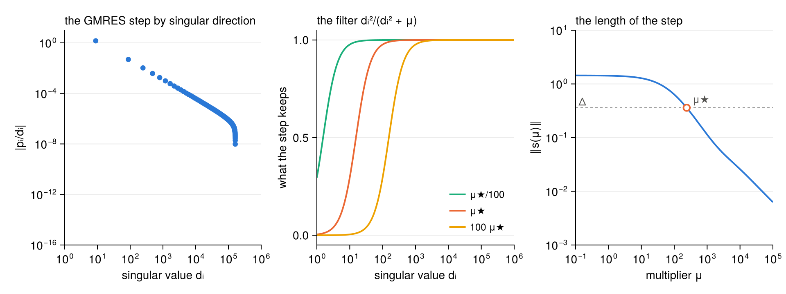

On the left, one singular direction carries nearly all of the GMRES step. In the middle, the filter
for the multiplier $\mu_\star$ of this radius and for two others. On the right, $\mu_\star$ is the
root of $\lVert s(\mu)\rVert = \Delta$. The script is
[`examples/how_it_works/how_it_works.jl`](examples/how_it_works/how_it_works.jl).

The two limits fix the path of the step as the radius changes. For $\mu \to \infty$, (6) gives
$s_i \to d_i p_i/\mu$, so $y$ is parallel to $V D\,p = H^{\mathsf T}\beta e_1$. This is minus the
gradient of $\tfrac12\lVert\beta e_1 - Hy\rVert^2$ at $y = 0$, the direction of steepest descent of
the model in the Krylov space. For $\mu \to 0$ the step is the GMRES step. In between, the end of
the step traces the curve of [the hookstep figure](#the-hookstep-and-the-classical-rule).

The stop of the Krylov space is on the residual of the GMRES step, not on that of the hookstep. On
the boundary of the trust region the residual of the model cannot go below a level set by $\Delta$,
whatever the dimension of the space, so it gives no criterion. Viswanath [2] uses the same stop,
and remarks that it has no theoretical support and works well in practice.

### The ratio of actual to predicted reduction

A trial step $\delta = Q_n y$ is judged on the true residual. The model predicts one reduction of
the squared residual and the trial gives another,

$$\text{predicted} = \beta^2 - \lVert \beta e_1 - H y\rVert^2, \qquad
\text{actual} = \lVert r\rVert^2 - \lVert F(x + \delta)\rVert^2, \qquad
\rho = \frac{\text{actual}}{\text{predicted}}. \tag{7}$$

A ratio near one says that the model holds at this distance. A trial is accepted when
$\rho > \eta$, with $\eta$ the keyword `eta`. The predicted reduction is positive for every step
considered here, since each has a model residual below $\beta$. With $\eta \ge 0$ an accepted step
therefore lowers $\lVert F\rVert$, by at least the fraction $\eta$ of what the model promised. A
ratio that is not a number counts as a rejection. When the Jacobian is singular to rounding the
computed prediction can lose its sign. The code divides by its size, so the ratio always has the
sign of the actual reduction.

### The rules of the radius

*The classical rule*, `trust=:classical`. The radius is a state carried from one iteration to the
next. A trial on the radius $\Delta$ with ratio $\rho$ gives the radius $\Delta/4$ if
$\rho < 1/4$ or the trial is rejected, the radius $\min(2\Delta, \Delta_{\max})$ if $\rho > 3/4$
and the step is on the boundary, and the same radius otherwise. A rejected trial is followed by the
hookstep on the smaller radius, in the same space. If the rejected trial was the GMRES step inside
the region, every radius above its length gives the same step, so the radius is divided by four
until it is below that length, with no new residual. The search collapses when the radius falls
below $\epsilon_{\text{mach}}(1 + \lVert x\rVert)$. This happens at a local minimum of
$\lVert F\rVert$ that is not a root. There $J^{\mathsf T}r = 0$, so the derivative of
$\lVert F(x + t\delta)\rVert^2$ at $t = 0$, which is $2\,r\cdot J\delta$, vanishes for every
$\delta$, and no short step lowers the residual by the fraction $\eta$ of a positive prediction.

*The greedy scan*, `trust=:scan, scan=:greedy`. From the radius $\Delta$, the hooksteps at the
radii $\Delta\,2^{j/2}$, $j = -6, \dots, 6$, each capped by $\Delta_{\max}$ and by the length of the
GMRES step, are tried once each. The trial of smallest residual among those with $\rho > \eta$ is
accepted, and the next radius is the length of its step. If none has $\rho > \eta$ the scan is
repeated from one eighth of the smallest radius tried.

*The longest step*, `trust=:scan, scan=:longest`. The search looks for the largest radius with
$\rho > \eta$. From $\Delta$ it doubles the radius while trials are accepted, up to
$\Delta_{\max}$ and to the length of the GMRES step, or halves it while they are rejected. Once it
holds an accepted radius $\Delta_a$ and a rejected one $\Delta_r > \Delta_a$ it tries their
geometric mean $\sqrt{\Delta_a\Delta_r}$, which replaces one of the two, until
$\Delta_r \le \sqrt2\,\Delta_a$. The accepted trial of largest radius is kept, and the next radius
is the length of its step. The bisection assumes that the accepted radii lie below the rejected
ones, and it returns an accepted step in any case.

### The acceptance test of backtracking

Backtracking is a line search along the Newton direction [20, 22]. It tries the steps
$\lambda\,\delta_N$ along the GMRES step, with $\lambda = 1$ first, or
$\lambda = \Delta_{\max}/\lVert\delta_N\rVert$ if that is smaller, and then half the last value. The
ratio (7) needs the prediction for $y = \lambda y_N$. Write $e = \beta e_1 - H y_N$ for the
residual of (4). It is orthogonal to the range of $H$, so $e\cdot\beta e_1 = \lVert e\rVert^2$, and

$$\lVert \beta e_1 - \lambda H y_N\rVert^2
= \lVert (1 - \lambda)\,\beta e_1 + \lambda e\rVert^2
= (1 - \lambda)^2\beta^2 + \lambda(2 - \lambda)\lVert e\rVert^2 .$$

The predicted reduction is therefore

$$\beta^2 - \lVert \beta e_1 - \lambda H y_N\rVert^2 = \lambda(2 - \lambda)\,\big(\beta^2 - \lVert e\rVert^2\big),$$

and the test of acceptance reads

$$\lVert F(x + \lambda\delta_N)\rVert^2 < \lVert r\rVert^2 - \eta\,\lambda(2 - \lambda)\,\big(\lVert r\rVert^2 - \lVert r + J\delta_N\rVert^2\big). \tag{8}$$

For an exact Newton step, $e = 0$, the right-hand side is $(1 - \eta\lambda(2 - \lambda))\lVert r\rVert^2$.
The test is one of sufficient decrease. For small $\lambda$ the left-hand side is
$\lVert r\rVert^2 + 2\lambda\,r\cdot J\delta_N + O(\lambda^2)$, and
$r\cdot J\delta_N = \lVert e\rVert^2 - \beta^2$ by the same orthogonality, so the actual and the
predicted reductions agree to first order in $\lambda$ and the ratio tends to one. Some fraction is
therefore always accepted in exact arithmetic. What the argument does not bound is its size. The
search collapses when $\lambda\lVert\delta_N\rVert$ falls below
$\epsilon_{\text{mach}}(1 + \lVert x\rVert)$.

### The second-order correction

To second order the residual along a step $\delta$ is

$$F(x + \delta) \approx r + J\delta + \tfrac12 F''[\delta, \delta].$$

A hookstep on the boundary, $v = Q_n y$ with multiplier $\mu > 0$, satisfies the damped normal
equations $(J^{\mathsf T}J + \mu I)\,v = -J^{\mathsf T}r$ restricted to the Krylov space, as noted
after (6). Add a correction $w$ of second order in $\lVert v\rVert$ and ask the same of the
second-order model. Keeping the terms up to second order, and neglecting the term in which the
second derivative acts on the residual, as Transtrum and Sethna [7] do,

$$J^{\mathsf T}\big(r + Jv + Jw + \tfrac12 F''[v, v]\big) + \mu\,(v + w) = 0.$$

Subtracting the equation of $v$ leaves $(J^{\mathsf T}J + \mu I)\,w = -\tfrac12 J^{\mathsf T}F''[v, v]$.
With $w = a/2$,

$$(J^{\mathsf T}J + \mu I)\,a = -J^{\mathsf T}F''[v, v], \qquad \delta = v + \tfrac12 a. \tag{9}$$

The names come from reading the step as a path, with $v$ its velocity and $a$ its acceleration [7].

The second derivative is not formed. Expanding $F(x + hv) = r + hJv + \tfrac12h^2F''[v, v] + O(h^3)$
gives the difference used here, with one more residual,

$$F''[v, v] \approx \frac{2}{h}\Big(\frac{F(x + hv) - r}{h} - Jv\Big), \qquad h = 0.1,$$

the formula and the step $h$ of [7]. The product $Jv$ costs nothing, since $Jv = Q_{n+1}Hy$ by (2).

The acceleration is sought in the same Krylov space, $a = Q_n z$. Then $Ja = Q_{n+1}Hz$, and with
$c = Q_{n+1}^{\mathsf T}F''[v, v]$ the coordinates of the second derivative on the basis, (9)
becomes $(H^{\mathsf T}H + \mu I)\,z = -H^{\mathsf T}c$. The part of $F''[v, v]$ outside the span of
$Q_{n+1}$ is orthogonal to $Ja$ for every $a$ in the space, so it does not enter. With the
decomposition of $H$ already at hand,

$$z = -V\,\mathrm{diag}\Big(\frac{d_i}{d_i^2 + \mu}\Big)\,U^{\mathsf T}c .$$

A trial is rejected, with no residual at its end point, if $\lVert a\rVert > \alpha\lVert v\rVert$,
the test of [7] with their value $\alpha = 0.75$ as default. Otherwise the residual at
$x + v + a/2$ is evaluated, and the ratio (7) compares the actual reduction there with the
reduction predicted for $v$. The radius bounds $\lVert v\rVert$ in every rule, and the next radius
of a scan is the length of the velocity. A GMRES step inside the region, $\mu = 0$, is taken
without acceleration. Near the root it converges quadratically already, and the difference above
along a very short $v$ is dominated by the rounding of $F$.

### Right preconditioning and the metric of the step

With a preconditioner $M$ the Arnoldi iteration runs on $JM^{-1}$, as in right-preconditioned
GMRES [4],

$$J M^{-1} Q_n = Q_{n+1} H, \qquad \delta = M^{-1}Q_n y = Z y, \qquad Z = [z_1, \dots, z_n],\ \ z_j = M^{-1}q_j .$$

The model is unchanged, $r + J\delta = Q_{n+1}(Hy - \beta e_1)$, and so is its norm in (3). What
changes is the length of the step, which is no longer $\lVert y\rVert$,

$$\lVert\delta\rVert^2 = y^{\mathsf T}Z^{\mathsf T}Z\,y = \lVert R y\rVert^2, \qquad R^{\mathsf T}R = G = Z^{\mathsf T}Z .$$

A bound on $\lVert y\rVert$ would bound $\lVert M\delta\rVert$. That norm is small in the
directions where $M^{-1}$ is large, which are the directions where the step is long and must be
restrained. So the trust region is kept on $\delta$. In the variable $u = Ry$ problem (5) becomes

$$\min_u\ \lVert \beta e_1 - H R^{-1}u\rVert \quad\text{subject to}\quad \lVert u\rVert \le \Delta,$$

the same problem with $HR^{-1}$ in place of $H$. Everything above then holds with the singular
value decomposition of $HR^{-1}$, including the multiplier, the lengths in the test of the
acceleration, and the fraction `λ`.

There are three sources of $R$.

- The default `gram` returns $G$. Its root is taken from the eigenvalues of $G$ scaled to unit
  diagonal.
- A `gram` of your own may return $G$, or the triangular $R$ itself.
- With `flexible=true` the vectors $z_j$ are kept and orthonormalised as they come, by Gram–Schmidt
  applied twice, $Z = WR$ with $W$ orthonormal. The step is then $WRy$, and $M$ could even change
  between Arnoldi steps, as flexible GMRES allows [4].

In each case the columns are scaled to unit length before the directions below $100$ machine
precisions, relative to the largest, are dropped. The scaling keeps the short vectors beside the
long ones. The difference between the sources is what the dropped directions are. From $R$ they are
the directions along which the scaled $z_j$ depend on each other to machine precision. From $G$,
which squares the condition of the vectors, they are the directions that depend on each other to
the square root of that, about $10^{-7}$. This is the loss seen in
[the example](#flexible-gmres).

### What a Newton iteration costs

One iteration with $n$ Arnoldi steps and $t$ trials costs the following.

| | no preconditioner | default `gram` | `gram` of your own | `flexible=true` |
|---|---:|---:|---:|---:|
| products with $J$ | $n$ | $n$ | $n$ | $n$ |
| evaluations of $F$ | $t$ | $t$ | $t$ | $t$ |
| applications of $M^{-1}$ | | $2n + t$ | $n + t$ | $n$ |
| updates of $J$ and of $M$ | 1 and 0 | 1 and 1 | 1 and 1 | 1 and 1 |
| vectors of the basis | $n + 1$ | $n + 1$ | $n + 1$ | $2n + 1$ |

An accelerated trial counts twice in the evaluations of $F$ and in the applications of $M^{-1}$
after the Arnoldi iteration. A finite-difference Jacobian adds one call of $F$ per product, or two
with central differences. The default `gram` holds $n$ more vectors while it runs. The
orthogonalisation takes about $n^2$ inner products, twice that with `flexible=true`, and the
default `gram` $n^2$ more. The singular value decomposition acts on a matrix of size $n$ and
touches no vector. A good preconditioner therefore saves twice, in the products and in the inner
products, which grow as $n^2$.

The diagram follows one iteration of the hookstep with the classical rule, with the colour of each
box for what it costs.

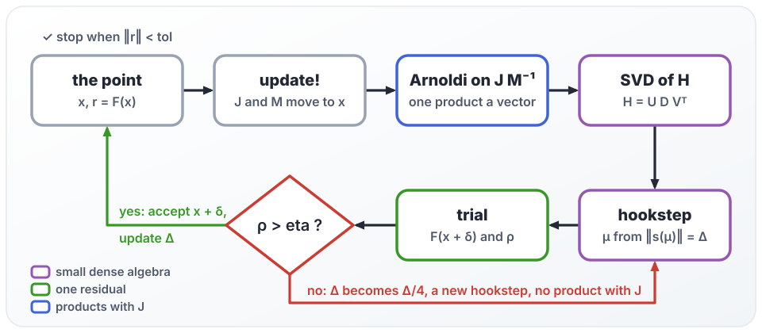

## Tests

```
julia --project -e 'using Pkg; Pkg.test()'
```

The tests are in four files beside the unit tests of the Jacobians and of the solver.

- [`test/test_claims.jl`](test/test_claims.jl) holds one test per claim on the behaviour of the
  solver, named after the claim.
- [`test/test_methods.jl`](test/test_methods.jl) runs the seven methods of
  [Globalisation](#globalisation) with the three built-in Jacobians on ten test problems, and checks
  the invariants of the trace on each search.
- [`test/test_preconditioning.jl`](test/test_preconditioning.jl) checks the preconditioner and the
  length of the step against dense algebra. On problems of a few unknowns, with a Krylov space that
  fills the space, the step that the solver takes is compared with the Newton step, with the
  trust-region step of the same radius and with the acceleration, each computed from the Jacobian as
  a matrix. This is done for every globalisation and for every way of giving the metric, which are
  no preconditioner, the default `gram`, a `gram` that returns $G$, one that returns $R$, and
  `flexible=true`. The file also checks the calls of `update!`, `ldiv!` and `gram` with a
  preconditioner that records them, and the numbers of the printed table against the trace.
- [`test/test_examples.jl`](test/test_examples.jl) runs a reduced version of the examples of this
  page, with one invariant of the physics of each. For the channel it is the balance of the total
  stress, and for Kolmogorov flow the balance of dissipation and input.

## References

Each entry says what this page takes from it. Entries 1 to 7 are the sources of what the package
implements, and entry 25 that of the second example. The others credit the methods and the model
that the package builds on.

1. D. Viswanath, *Recurrent motions within plane Couette turbulence*, J. Fluid Mech. 580 (2007)
   339–358. [doi](https://doi.org/10.1017/S0022112007005459). Section 2.3 computes the hookstep
   within a Krylov subspace from the singular value decomposition of the Hessenberg matrix, with the
   radius varied by comparing the actual and the predicted reduction.
2. D. Viswanath, *The critical layer in pipe flow at high Reynolds number*, Phil. Trans. R. Soc. A
   367 (2009) 561–576. [doi](https://doi.org/10.1098/rsta.2008.0225),
   [arXiv](https://arxiv.org/abs/0809.1498). Section 5 gives the method in detail, with formula (6)
   for the step and the stop on the residual of GMRES.
3. D. A. Knoll and D. E. Keyes, *Jacobian-free Newton–Krylov methods: a survey of approaches and
   applications*, J. Comput. Phys. 193 (2004) 357–397.
   [doi](https://doi.org/10.1016/j.jcp.2003.08.010). The matrix-free product by a finite
   difference, the trade-off of inexact Newton methods, and right preconditioning.
4. Y. Saad, *A flexible inner-outer preconditioned GMRES algorithm*, SIAM J. Sci. Comput. 14 (1993)
   461–469. [doi](https://doi.org/10.1137/0914028). GMRES with right preconditioning, and the
   flexible variant that keeps the preconditioned vectors and lets the preconditioner change.
5. L. Giraud, J. Langou and M. Rozložník, *The loss of orthogonality in the Gram–Schmidt
   orthogonalization process*, Comput. Math. Appl. 50 (2005) 1069–1075.
   [doi](https://doi.org/10.1016/j.camwa.2005.08.009). One reorthogonalisation keeps the vectors
   orthogonal to machine precision.
6. M. K. Transtrum, B. B. Machta and J. P. Sethna, *Geometry of nonlinear least squares with
   applications to sloppy models and optimization*, Phys. Rev. E 83 (2011) 036701.
   [doi](https://doi.org/10.1103/PhysRevE.83.036701), [arXiv](https://arxiv.org/abs/1010.1449).
   Section VIII C, the delayed gratification.
7. M. K. Transtrum and J. P. Sethna, *Improvements to the Levenberg-Marquardt algorithm for nonlinear
   least-squares minimization*, [arXiv:1201.5885](https://arxiv.org/abs/1201.5885) (2012). Section 3,
   the geodesic acceleration, its finite difference with $h = 0.1$, and the test on the length of
   the acceleration with $\alpha = 0.75$.
8. W. E. Arnoldi, *The principle of minimized iterations in the solution of the matrix eigenvalue
   problem*, Q. Appl. Math. 9 (1951) 17–29. [doi](https://doi.org/10.1090/qam/42792). The Arnoldi
   iteration.
9. Y. Saad and M. H. Schultz, *GMRES: a generalized minimal residual algorithm for solving
   nonsymmetric linear systems*, SIAM J. Sci. Stat. Comput. 7 (1986) 856–869.
   [doi](https://doi.org/10.1137/0907058). GMRES.
10. P. N. Brown and Y. Saad, *Hybrid Krylov methods for nonlinear systems of equations*, SIAM J. Sci.
    Stat. Comput. 11 (1990) 450–481. [doi](https://doi.org/10.1137/0911026). Newton–Krylov methods.
11. P. N. Brown and Y. Saad, *Convergence theory of nonlinear Newton–Krylov algorithms*, SIAM J.
    Optim. 4 (1994) 297–330. [doi](https://doi.org/10.1137/0804017). Newton–Krylov methods.
12. C. T. Kelley, *Solving Nonlinear Equations with Newton's Method*, SIAM (2003).
    [doi](https://doi.org/10.1137/1.9780898718898). Newton–Krylov methods.
13. M. Pernice and H. F. Walker, *NITSOL: a Newton iterative solver for nonlinear systems*, SIAM J.
    Sci. Comput. 19 (1998) 302–318. [doi](https://doi.org/10.1137/S1064827596303843). A
    Newton–Krylov solver.
14. R. S. Dembo, S. C. Eisenstat and T. Steihaug, *Inexact Newton methods*, SIAM J. Numer. Anal. 19
    (1982) 400–408. [doi](https://doi.org/10.1137/0719025). Inexact Newton methods.
15. S. C. Eisenstat and H. F. Walker, *Choosing the forcing terms in an inexact Newton method*, SIAM
    J. Sci. Comput. 17 (1996) 16–32. [doi](https://doi.org/10.1137/0917003). The forcing terms.
16. K. Levenberg, *A method for the solution of certain non-linear problems in least squares*, Q.
    Appl. Math. 2 (1944) 164–168. [doi](https://doi.org/10.1090/qam/10666). The damped least-squares
    step.
17. D. W. Marquardt, *An algorithm for least-squares estimation of nonlinear parameters*, J. Soc.
    Indust. Appl. Math. 11 (1963) 431–441. [doi](https://doi.org/10.1137/0111030). The damped
    least-squares step.
18. J. J. Moré, *The Levenberg–Marquardt algorithm: implementation and theory*, in *Numerical
    Analysis*, Lecture Notes in Mathematics 630, Springer (1978) 105–116.
    [doi](https://doi.org/10.1007/BFb0067700). The trust-region subproblem.
19. J. J. Moré and D. C. Sorensen, *Computing a trust region step*, SIAM J. Sci. Stat. Comput. 4
    (1983) 553–572. [doi](https://doi.org/10.1137/0904038). The trust-region subproblem.
20. J. E. Dennis and R. B. Schnabel, *Numerical Methods for Unconstrained Optimization and Nonlinear
    Equations*, SIAM (1996). [doi](https://doi.org/10.1137/1.9781611971200). The hookstep and line
    searches.
21. A. R. Conn, N. I. M. Gould and P. L. Toint, *Trust Region Methods*, SIAM (2000).
    [doi](https://doi.org/10.1137/1.9780898719857). Trust-region methods.
22. J. Nocedal and S. J. Wright, *Numerical Optimization*, 2nd edition, Springer (2006).
    [doi](https://doi.org/10.1007/978-0-387-40065-5). Trust-region methods and line searches.
23. A. Griewank and A. Walther, *Evaluating Derivatives*, 2nd edition, SIAM (2008).
    [doi](https://doi.org/10.1137/1.9780898717761). Automatic differentiation.
24. P. R. Spalart and S. R. Allmaras, *A one-equation turbulence model for aerodynamic flows*, La
    Recherche Aérospatiale 1 (1994) 5–21. The turbulence model of the channel example.
25. M. Golden, *A catalog of exact steady states in Kolmogorov flow*,
    [arXiv:2609.27062](https://arxiv.org/abs/2609.27062) (2026). Section 2, the equations, the grid,
    the guesses of filtered noise and the preconditioner of the Kolmogorov example.
