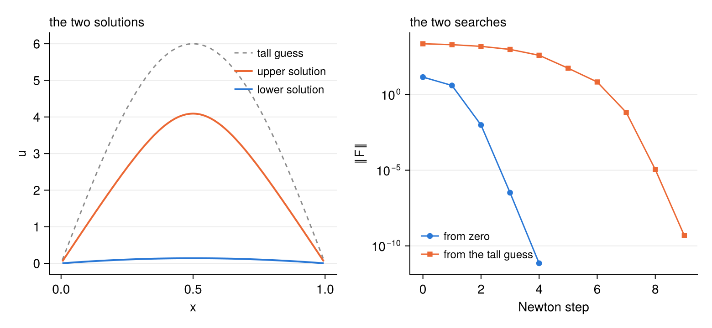
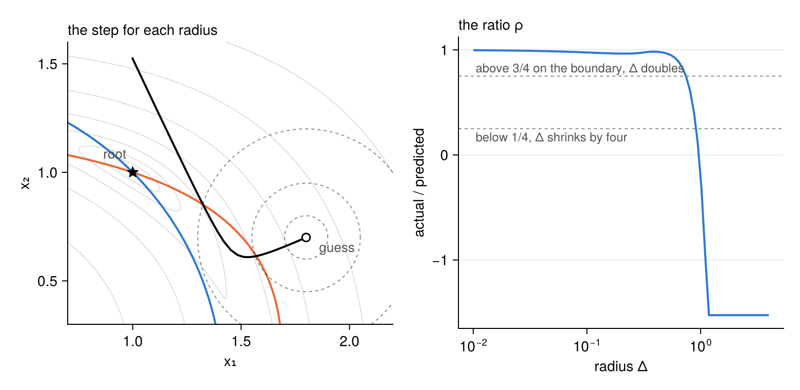
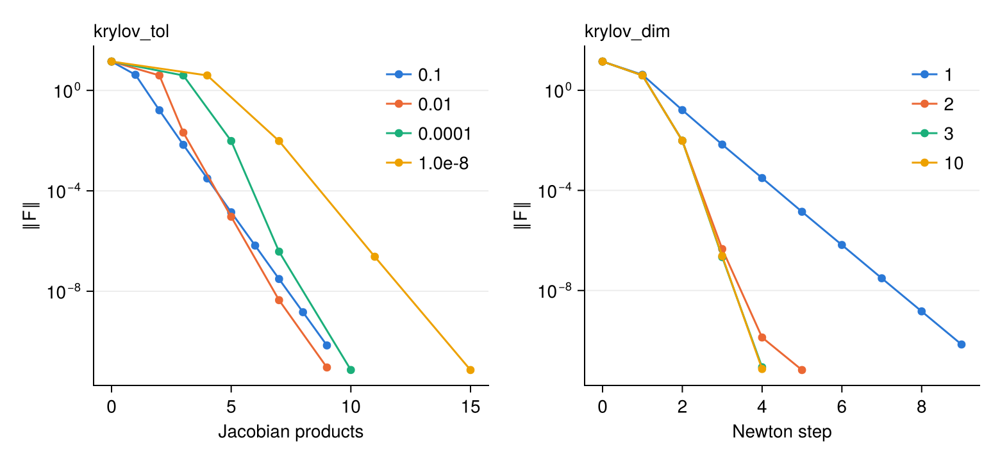
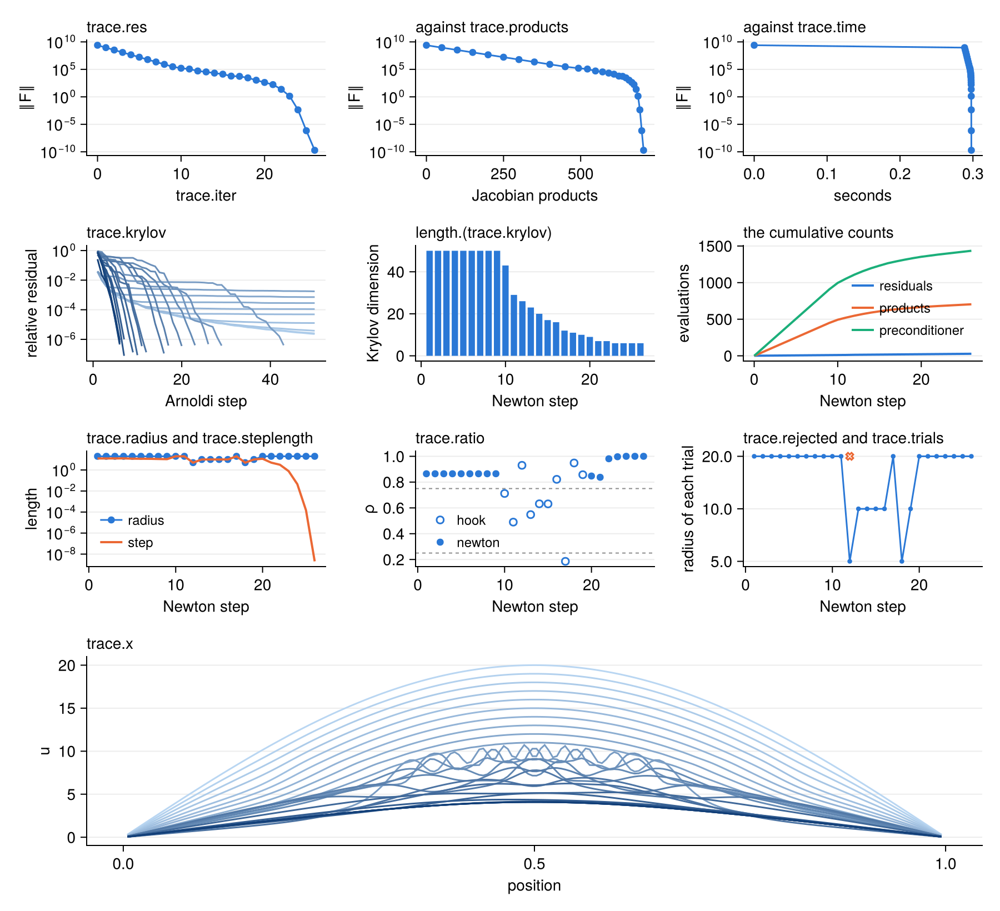
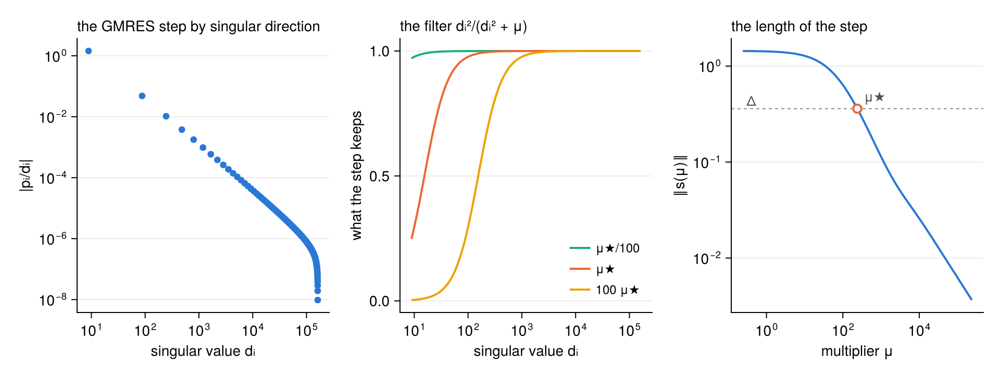

<p align="center">
  
</p>

# NKRoots.jl

A Newton–Krylov hookstep solver for `F(x) = 0` in Julia. It needs only the product of the Jacobian
with a vector, so it suits large systems, and `x` can be any type that broadcasts.

The step comes from a trust region in a Krylov space, the hookstep of Viswanath. A rejected step costs
one residual and no new Krylov space. The Jacobian can be a finite difference, dual numbers or your
own operator. A right preconditioner is optional, and the trust region stays on the step in `x`. The
radius follows the classical rule or a scan. `Trace` records everything a search does.


**Examples.** [A first search](#a-first-search) ·
[The Jacobian](#the-jacobian) ·
[The Bratu problem](#the-bratu-problem) ·
[The hookstep](#the-hookstep) ·
[The radius](#the-radius) ·
[The Krylov space](#the-krylov-space) ·
[Preconditioners](#preconditioners) ·
[Tracing](#tracing) ·
[A turbulent channel](#a-turbulent-channel)

**Reference.** [How it works](#how-it-works) · [Keywords](#keywords) · [Tests](#tests) · [References](#references)

## Installation

```julia
using Pkg
Pkg.add(url="https://github.com/Davide-Lasagna-s-Lab/NKRoots.jl")
```

The scripts of `examples/` have their own environment, with CairoMakie for the figures.

```
julia --project=examples -e 'using Pkg; Pkg.instantiate()'
julia --project=examples examples/route.jl
```

## A first search

Two equations in two unknowns, the circle $x_1^2 + x_2^2 = 2$ and the curve
$e^{x_1 - 1} + x_2^3 = 2$. The function writes the residual into `out` and returns it. The guess `x` is
overwritten with the root.

```julia
using NKRoots

function two!(out, x)
    out[1] = x[1]^2 + x[2]^2 - 2
    out[2] = exp(x[1] - 1) + x[2]^3 - 2
    return out
end

x   = [1.8, 0.7]
out = nkroot!(two!, x; Δ=0.1, tol=1e-12)
```

Each row of the output is one Newton step, and the last line says how the search ended.

```
╭──────┬────────────┬──────────┬─────────┬───────┬────────────┬──────────┬──────╮
│ iter │        ‖F‖ │        Δ │       ρ │ dim K │ ‖Jδ+F‖/‖F‖ │     step │ rej. │
├──────┼────────────┼──────────┼─────────┼───────┼────────────┼──────────┼──────┤
│    0 │ 1.8210e+00 │ 1.00e-01 │         │       │            │          │      │
│    1 │ 1.3909e+00 │ 2.00e-01 │   0.976 │     2 │   6.59e-34 │   ↪ hook │    0 │
│    2 │ 6.7069e-01 │ 4.00e-01 │   0.973 │     2 │   5.32e-33 │   ↪ hook │    0 │
│    3 │ 3.3101e-01 │ 8.00e-01 │   0.967 │     2 │   7.72e-32 │   ↪ hook │    0 │
│    4 │ 1.1106e-01 │ 8.00e-01 │   0.887 │     2 │   2.62e-32 │ → newton │    0 │
│    5 │ 1.7982e-03 │ 8.00e-01 │   1.000 │     2 │   0.00e+00 │ → newton │    0 │
│    6 │ 1.4706e-06 │ 8.00e-01 │   1.000 │     2 │   0.00e+00 │ → newton │    0 │
│    7 │ 9.9742e-13 │ 8.00e-01 │   1.000 │     2 │   0.00e+00 │ → newton │    0 │
╰──────┴────────────┴──────────┴─────────┴───────┴────────────┴──────────┴──────╯
  ✓ converged: 7 steps, ‖F‖ = 9.974e-13, 8 residuals, 14 Jacobian products
```

| column | meaning |
|---|---|
| `iter` | the Newton step |
| `‖F‖` | the norm of the residual |
| `Δ` | the radius of the trust region for the next step |
| `ρ` | the actual reduction of ‖F‖² over the one the linear model predicted |
| `dim K` | the dimension of the Krylov space |
| `‖Jδ+F‖/‖F‖` | how well GMRES solved the Newton system $J\delta = -F$ |
| `step` | `↪ hook` on the boundary of the trust region, `→ newton` the full step inside it |
| `rej.` | the trial steps rejected before the accepted one |

The radius starts small and doubles while the linear model is good. The first three steps sit on
the boundary of the trust region. The last four are full Newton steps, and the residual falls
quadratically.

The function returns `(status = :converged, iter = 7, res = 9.97e-13)`, and `x` is the root `(1, 1)`.

The figure at the top shows four searches on the landscape of $\tfrac12\|F\|^2$. The blue and orange
curves are the two equations, and they cross at the two roots, the stars. Three searches reach a
root. The fourth, from `(1.6, -1.2)`, ends in a valley with no root and stops with
`✗ trust region collapsed`. A hookstep lowers $\|F\|$, so it finds a local minimum of $\|F\|$ if the
guess leads there.

Script: [`examples/route.jl`](examples/route.jl).

## The Jacobian

There are three ways to give it. A finite difference is the default, `jacobian=:ad` uses dual numbers,
and any object with `mul!` will do. `update!(J, x, r)` moves your own object to the point `x`, with
`r = F(x)`, at the start of every Newton step.

```julia
using LinearAlgebra

x = [1.8, 0.7]
nkroot!(two!, x; jacobian=:fd, Δ=0.1, verbose=false)          # the default
x = [1.8, 0.7]
nkroot!(two!, x; jacobian=:ad, Δ=0.1, verbose=false)          # dual numbers
x = [1.8, 0.7]
nkroot!(two!, x; jacobian=:fd, ϵ=1e-2, Δ=0.1, verbose=false)  # a relative step for the difference

struct TwoJacobian
    A::Matrix{Float64} # the matrix at the last point
end

function NKRoots.update!(J::TwoJacobian, x, r)
    J.A[1, 1] = 2x[1]
    J.A[1, 2] = 2x[2]
    J.A[2, 1] = exp(x[1] - 1)
    J.A[2, 2] = 3x[2]^2
    return J
end

LinearAlgebra.mul!(out, J::TwoJacobian, v) = mul!(out, J.A, v)

x = [1.8, 0.7]
nkroot!(two!, TwoJacobian(zeros(2, 2)), x; Δ=0.1, verbose=false)
```

The three exact Jacobians follow the same path. A coarse finite difference still converges, because
the residual is exact, but it loses the fast final phase of Newton's method.


Script: [`examples/jacobians.jl`](examples/jacobians.jl).

## The Bratu problem

The equation $u'' + e^u = 0$ with $u(0) = u(1) = 0$ has two solutions, and the guess decides which one
a search finds. By second differences on 200 points the residual is

```julia
n = 200
h = 1/(n + 1)

function bratu!(out, u)
    for i in 1:n
        left   = i == 1 ? zero(u[i]) : u[i - 1]
        right  = i == n ? zero(u[i]) : u[i + 1]
        out[i] = (left - 2u[i] + right)/h^2 + exp(u[i])
    end
    return out
end

A = Tridiagonal(fill(1/h^2, n - 1), fill(-2/h^2, n), fill(1/h^2, n - 1))

low  = zeros(n)
high = [6*sin(π*i*h) for i in 1:n]
nkroot!(bratu!, low; precond=lu(A), Δ=1.0, krylov_tol=1e-6, tol=1e-8, maxiter=60, verbose=false)
nkroot!(bratu!, high; precond=lu(A), Δ=1.0, krylov_tol=1e-6, tol=1e-8, maxiter=60, verbose=false)
```

From zero the search finds the lower solution, with a maximum of 0.1405. From a tall guess it finds
the upper one, with a maximum of 4.091. Both solutions are known in closed form, and the computed ones
agree with them to the error of the second differences.



Script: [`examples/bratu.jl`](examples/bratu.jl).

## The hookstep

The radius Δ bounds the step. On a small radius the step follows the steepest descent, and as Δ grows
it turns towards the Newton step. From the guess `(1.8, 0.7)` the Newton step lands above the root and
raises the residual. The ratio ρ of the actual to the predicted reduction says how far the linear
model can be trusted. The search reads it after each trial.

To see one step on a given radius, fix the radius with `Δmax` and accept every trial with `eta`.

```julia
x = [1.8, 0.7]
nkroot!(two!, x; jacobian=:ad, Δ=0.25, Δmax=0.25, eta=-Inf, maxiter=1, verbose=false)
```



The dashed circles have radii 0.1, 0.25 and 0.5. The black curve is the end of the step as Δ grows.

Script: [`examples/hookstep.jl`](examples/hookstep.jl).

## The radius

With `trust=:ratio`, the default, the radius moves after each trial. It shrinks by four below
ρ = 1/4 and doubles above ρ = 3/4 on the boundary. With `trust=:scan` the hooksteps at the radii Δ/8
to 4Δ in steps of √2 are all tried in the same Krylov space, and the best is kept. The next radius is
the length of that step.

```julia
x = [2.5, 2.0]
nkroot!(two!, x; jacobian=:ad, trust=:scan, Δ=1.0, verbose=false)
```

A trial costs one residual and no Jacobian product. A scan pays off when the Krylov space costs much
more than a residual, as it does for a long search with many products per step. On these two
equations it only costs more. Three options shape the search.

- `Δ` is the first radius. A small one wastes steps while the radius doubles.
- `Δmax` is the largest radius. A small cap forces a crawl.
- `eta` is the smallest ratio for a step to be accepted. A large one rejects more trials.


Script: [`examples/update_rules.jl`](examples/update_rules.jl).

## The Krylov space

`krylov_tol` sets how well each Newton system is solved. A loose tolerance gives linear convergence
with cheap steps, and a tight one the quadratic convergence of Newton's method at more products per
step. `krylov_dim` caps the size of the space. A space of one vector still converges, about one digit
per step. Here both act on the Bratu problem from zero.

```julia
u = zeros(n)
nkroot!(bratu!, u; precond=lu(A), krylov_tol=1e-2, krylov_dim=10, Δ=1.0, tol=1e-10, maxiter=40, verbose=false)
```



Script: [`examples/krylov.jl`](examples/krylov.jl).

## Preconditioners

A right preconditioner is any object with `ldiv!(out, M, v)`. On the Bratu problem the LU factorisation
of the second differences cuts the Jacobian products of a search from 561 to 12, with the same
solution. The left panel shows one Newton system. Without the preconditioner GMRES stagnates until it
has filled half of the space.

Use `flexible=true` with a preconditioner that solves a few directions exactly. It stretches some
vectors far beyond the others, and a Gram matrix of them loses the short ones to rounding. Flexible
GMRES keeps them. The right panel is a linear system with one eigenvalue of $10^{-7}$, and a
preconditioner that is exact on that direction. After twenty steps the Gram matrix is still at $3\times 10^{-7}$.
Flexible GMRES gets to $5\times 10^{-9}$ in one step.

```julia
out = nkroot!(linear!, B, x; precond=M, flexible=true, Δ=1e8, krylov_dim=40, krylov_tol=1e-10)
```


A preconditioner that depends on the point defines `update!(M, x)`, which the search calls at every
Newton step. The channel below uses one.

Script: [`examples/preconditioner.jl`](examples/preconditioner.jl).

## Tracing

A `Trace` is a callback. After the search it holds the whole history.

```julia
trace = Trace(keep=true)
u     = [20*sin(π*i*h) for i in 1:n]
nkroot!(bratu!, u; precond=lu(A), Δ=20.0, krylov_tol=1e-6, tol=1e-9, maxiter=60, verbose=false, callback=trace)

trace                # prints one row per step
trace.res            # residual norms
trace.iter           # Newton steps
trace.time           # seconds since the start
trace.products       # Jacobian products, cumulative
trace.residuals      # residuals, cumulative
trace.preconditioner # applications of M⁻¹, cumulative
trace.krylov         # the GMRES residual after each Arnoldi step, for each Newton step
trace.step           # "newton" or "hook"
trace.radius         # the radius of each accepted step
trace.steplength     # its length
trace.ratio          # its ratio
trace.rejected       # the rejected trials of each step
trace.trials         # the radius and the ratio of each of them
trace.x              # the iterates, with keep=true
```

Printed, it gives

```
Trace with 27 records
╭──────┬────────────┬──────────┬─────────┬───────┬──────────┬──────┬─────────╮
│ iter │        ‖F‖ │        Δ │       ρ │ dim K │ products │ rej. │    time │
├──────┼────────────┼──────────┼─────────┼───────┼──────────┼──────┼─────────┤
│    0 │ 2.4470e+09 │ 2.00e+01 │         │       │        0 │      │     0.0 │
│    1 │ 9.0019e+08 │ 2.00e+01 │   0.865 │    50 │       50 │    0 │     0.3 │
│    2 │ 3.3116e+08 │ 2.00e+01 │   0.865 │    50 │      100 │    0 │     0.3 │
│    3 │ 1.2183e+08 │ 2.00e+01 │   0.865 │    50 │      150 │    0 │     0.3 │
│    4 │ 4.4817e+07 │ 2.00e+01 │   0.865 │    50 │      200 │    0 │     0.3 │
│    5 │ 1.6487e+07 │ 2.00e+01 │   0.865 │    50 │      250 │    0 │     0.3 │
│    6 │ 6.0649e+06 │ 2.00e+01 │   0.865 │    50 │      300 │    0 │     0.3 │
│    7 │ 2.2308e+06 │ 2.00e+01 │   0.865 │    50 │      350 │    0 │     0.3 │
│    8 │ 8.2030e+05 │ 2.00e+01 │   0.865 │    50 │      400 │    0 │     0.3 │
│    9 │ 3.0144e+05 │ 2.00e+01 │   0.865 │    50 │      450 │    0 │     0.3 │
│   10 │ 1.6183e+05 │ 2.00e+01 │   0.712 │    43 │      493 │    0 │     0.3 │
│   11 │ 1.1560e+05 │ 2.00e+01 │   0.490 │    29 │      522 │    0 │     0.3 │
│   12 │ 5.1087e+04 │ 5.00e+00 │   0.930 │    26 │      548 │    1 │     0.3 │
│   13 │ 3.4508e+04 │ 1.00e+01 │   0.548 │    23 │      571 │    0 │     0.3 │
│   14 │ 2.1010e+04 │ 1.00e+01 │   0.632 │    20 │      591 │    0 │     0.3 │
│   15 │ 1.3403e+04 │ 1.00e+01 │   0.631 │    17 │      608 │    0 │     0.3 │
│   16 │ 5.9771e+03 │ 1.00e+01 │   0.821 │    16 │      624 │    0 │     0.3 │
│   17 │ 5.4071e+03 │ 2.00e+01 │   0.186 │    12 │      636 │    0 │     0.3 │
│   18 │ 2.8238e+03 │ 5.00e+00 │   0.948 │    11 │      647 │    0 │     0.3 │
│   19 │ 1.0732e+03 │ 1.00e+01 │   0.857 │    10 │      657 │    0 │     0.3 │
│   20 │ 4.1956e+02 │ 2.00e+01 │   0.847 │     9 │      666 │    0 │     0.3 │
│   21 │ 1.6917e+02 │ 2.00e+01 │   0.837 │     7 │      673 │    0 │     0.3 │
│   22 │ 2.3304e+01 │ 2.00e+01 │   0.981 │     7 │      680 │    0 │     0.3 │
│   23 │ 1.3397e+00 │ 2.00e+01 │   0.997 │     6 │      686 │    0 │     0.3 │
│   24 │ 4.3301e-03 │ 2.00e+01 │   1.000 │     6 │      692 │    0 │     0.3 │
│   25 │ 6.9034e-07 │ 2.00e+01 │   1.000 │     6 │      698 │    0 │     0.3 │
│   26 │ 1.8961e-10 │ 2.00e+01 │   1.000 │     6 │      704 │    0 │     0.3 │
╰──────┴────────────┴──────────┴─────────┴───────┴──────────┴──────┴─────────╯
```

and every field can be plotted. Here the search starts far above the solution with a preconditioner
of the Laplacian alone. It walks down on full Krylov spaces, spends a few hooksteps near the fold of
the nonlinearity, and ends with the quadratic phase. The last panel shows the iterates, light to dark.



A callback of your own receives the state of the search and stops it by returning `true`. Call the
trace first to keep both. The output can go to a file with `io`, or be silenced with `verbose`.

```julia
trace = Trace()
stop  = info -> (trace(info); info.res < 1e-3 || info.iter >= 15)

u = zeros(n)
open(tempname(), "w") do io
    nkroot!(bratu!, u; precond=lu(A), Δ=1.0, tol=1e-10, maxiter=20, io=io, callback=stop)
end
```

Script: [`examples/tracing.jl`](examples/tracing.jl).

## A turbulent channel

The mean flow of a turbulent channel with the Spalart–Allmaras model. Two coupled fields, a strong
nonlinearity and a stiff operator make this a real test for a Krylov solver.

**The equations.** In units of the half height and of the friction velocity, with $\nu = 1/Re_\tau$, on
$0 \le y \le 1$, the streamwise momentum balance and the transport of the working variable
$\tilde\nu$ are

$$\frac{d}{dy}\Big[(\nu + \nu_t)\frac{dU}{dy}\Big] + 1 = 0,$$

$$\underbrace{c_{b1}\tilde S\tilde\nu}_{\text{production}}
- \underbrace{c_{w1}f_w\Big(\frac{\tilde\nu}{y}\Big)^2}_{\text{destruction}}
+ \underbrace{\frac{1}{\sigma}\frac{d}{dy}\Big[(\nu + \tilde\nu)\frac{d\tilde\nu}{dy}\Big]
+ \frac{c_{b2}}{\sigma}\Big(\frac{d\tilde\nu}{dy}\Big)^2}_{\text{diffusion}} = 0,$$

with $U = \tilde\nu = 0$ at the wall and zero gradients at the centre. The closures are

$$\nu_t = \tilde\nu f_{v1}, \qquad f_{v1} = \frac{\chi^3}{\chi^3 + c_{v1}^3}, \qquad \chi = \frac{\tilde\nu}{\nu},$$

$$\tilde S = \Big|\frac{dU}{dy}\Big| + \frac{\tilde\nu}{\kappa^2y^2}f_{v2}, \qquad f_{v2} = 1 - \frac{\chi}{1 + \chi f_{v1}},$$

$$f_w = g\Big(\frac{1 + c_{w3}^6}{g^6 + c_{w3}^6}\Big)^{1/6}, \qquad g = r + c_{w2}(r^6 - r), \qquad r = \min\Big(\frac{\tilde\nu}{\tilde S\kappa^2y^2}, 10\Big),$$

with $\tilde S$ kept above $0.3\,|dU/dy|$, and no trip terms. The constants are
$c_{b1} = 0.1355$, $c_{b2} = 0.622$, $\sigma = 2/3$, $\kappa = 0.41$, $c_{w1} = c_{b1}/\kappa^2 + (1 + c_{b2})/\sigma$,
$c_{w2} = 0.3$, $c_{w3} = 2$ and $c_{v1} = 7.1$.

**The discretisation.** The derivatives are the fourth-order finite differences of
[FDGrids.jl](https://github.com/Davide-Lasagna-s-Lab/FDGrids.jl), with five-point stencils on 300
points stretched towards the wall. They are plain matrices, with the even symmetry of both fields at
the centre. The unknown `x` holds the two fields, `[U; ν̃]`.

```julia
ξ    = range(0, 1; length=N + 1)
y    = collect(@. 1 - tanh(3(1 - ξ))/tanh(3))
ends = (NoSymmetry(), EvenSymmetry(1.0))
D₁   = full(DiffMatrix(y, 5, 1; symmetry=ends))[2:end, 2:end]
D₂   = full(DiffMatrix(y, 5, 2; symmetry=ends))[2:end, 2:end]
```

**The diffusion.** Both equations hold the same operator,

$$\mathcal D_a = \frac{d}{dy}\,a\,\frac{d}{dy} = a\frac{d^2}{dy^2} + \frac{da}{dy}\frac{d}{dy},$$

a Laplacian with a variable coefficient, $a = \nu + \nu_t$ for the velocity and
$a = (\nu + \tilde\nu)/\sigma$ for $\tilde\nu$. As a matrix it is one line.

```julia
diffusion(a) = Diagonal(a)*D₂ + Diagonal(D₁*a)*D₁
```

It is the stiff term, for two reasons. The first is its size. The wall needs a fine grid, with a first
spacing $h$ of $10^{-4}$, so the second derivative has entries of order $a/h^2$, about $10^5$ at
$Re_\tau = 1000$. Production and destruction hold no second derivative and stay far smaller. The
second is its reach. A row of the matrix couples a point to its two neighbours on each side, so one
product with the Jacobian moves information by two points. The wall must reach the centre across 300
points, and GMRES needs a Krylov space nearly as large as the system.

A direct solve of the diffusion removes both problems, so it is the right preconditioner,

$$M = \begin{pmatrix} \mathcal D_{\nu + \nu_t} & 0 \\ 0 & \mathcal D_{(\nu + \tilde\nu)/\sigma} \end{pmatrix}.$$

The Jacobian times $M^{-1}$ is then the identity plus production, destruction and the coupling of the
two fields, all divided by the diffusion. These are mild, and GMRES needs about 14 products per
Newton step. The coefficients depend on the point, so `update!` factorises $M$ again at each step.

```julia
function NKRoots.update!(M::Diffusion, x)
    c   = M.c
    p   = max.(x[c.N + 1:2c.N], 0.0)
    νt  = p .* fv1.(p ./ c.ν)
    M.A = lu(diffusion(c, c.ν .+ νt))
    M.B = lu(diffusion(c, (c.ν .+ p) ./ σ))
    return M
end
```

**The search.** It goes up in the Reynolds number, and each solution is the guess of the next. Six
values from 180 to 5200 take between 16 and 58 Newton steps each. Here is one step of the
continuation, from the solution at 550 to the one at 1000.

| preconditioner | Jacobian products | outcome |
|---|---:|---|
| none | 12000 | ‖F‖ = 1.2 after 40 steps |
| the Laplacian `ν D₂` on both fields, factorised once | 1909 | converged in 29 steps |
| the diffusion, factorised at each step | 385 | converged in 28 steps |

The Laplacian alone has the right form and the wrong size, because the eddy viscosity away from the
wall is a hundred times the viscosity. The two preconditioners take about the same Newton steps,
since GMRES solves to the same tolerance, and the diffusion needs five times fewer products. The last
panel below has logarithmic axes, because both fall almost at once on a linear one.


**The checks.** The momentum equation integrates to $(\nu + \nu_t)\,dU/dy = 1 - y$. The error of this
balance at $Re_\tau = 1000$ falls with the fourth power of the spacing, as the stencils promise.

| points | error of the total stress | order |
|---:|---:|---:|
| 150 | $6.90\times 10^{-5}$ | |
| 300 | $4.32\times 10^{-6}$ | 4.00 |
| 600 | $2.70\times 10^{-7}$ | 4.00 |

In the log layer $\tilde\nu^+ = \kappa y^+$, the middle panel, as the model was built to give.

Script: [`examples/spalart_allmaras.jl`](examples/spalart_allmaras.jl).

## How it works

We look for $x \in \mathbb{R}^N$ with $F(x) = 0$. The figure shows one Newton step. The Krylov space is
built once, at one product with the Jacobian per vector. The trust region then tries steps inside
that space, at one residual per trial. The rest is dense algebra on a small matrix. This division of
the work is the point of the method.


### The linear model

At a point $x$ with residual $r = F(x)$ and Jacobian $J$, the residual near $x$ is modelled by

$$F(x + \delta) \approx r + J\delta.$$

Newton's method makes the model vanish, $J\delta = -r$. Two things stand in the way. For a large
system $J$ cannot be stored or factorised. Far from a root the solution of the model is a poor step,
as [the hookstep example](#the-hookstep) shows. The Krylov space answers the first and the trust
region the second.

### From the system to the Krylov space

Let $\beta = \|r\|$ and $q_1 = -r/\beta$. The Arnoldi iteration builds an orthonormal basis
$Q_n = [q_1, \dots, q_n]$ of the space spanned by $r, Jr, \dots, J^{n-1}r$. Each new vector takes one
product with $J$. The coefficients of the orthonormalisation form the $(n + 1) \times n$ upper
Hessenberg matrix $H$, with

$$J Q_n = Q_{n+1} H.$$

Take a step in this space, $\delta = Q_n y$. The residual of the model is

$$r + J\delta = -\beta q_1 + Q_{n+1} H y = Q_{n+1}(Hy - \beta e_1),$$

and because the columns of $Q_{n+1}$ are orthonormal,

$$\|r + J\delta\| = \|\beta e_1 - Hy\|, \qquad \|\delta\| = \|y\|.$$

A problem of size $N$ has become a problem of size $n$. GMRES is its minimum with no constraint on
$y$. A Givens rotation of the new column of $H$ updates the residual of GMRES at every Arnoldi step,
with no operation on vectors. That residual is the column `‖Jδ+F‖/‖F‖` of the output. The space stops
growing when it falls below `krylov_tol`, at `krylov_dim`, or at a breakdown, when the new vector
vanishes because the space is invariant. Two passes of modified Gram–Schmidt keep $Q_n$ orthonormal
to rounding.

### The constrained step

The trust region asks for the best step of length at most $\Delta$,

$$\min_y \|\beta e_1 - Hy\| \quad \text{subject to} \quad \|y\| \le \Delta.$$

The singular value decomposition $H = U D V^{\mathsf T}$ decouples it. With $p = \beta U^{\mathsf T} e_1$
and $s = V^{\mathsf T} y$, we minimise $\sum_i (p_i - d_i s_i)^2$ subject to $\sum_i s_i^2 \le \Delta^2$.
A Lagrange multiplier $\mu \ge 0$ on the constraint gives, direction by direction,

$$s_i(\mu) = \frac{d_i\, p_i}{d_i^2 + \mu} = \frac{d_i^2}{d_i^2 + \mu}\;\frac{p_i}{d_i}.$$

This is the Levenberg–Marquardt step on the small problem, $(H^{\mathsf T}H + \mu I)\,y = \beta H^{\mathsf T}e_1$.
There are two cases.

- The GMRES step, $\mu = 0$, lies inside the region. It is the answer, `→ newton`.
- Otherwise $\mu$ solves $\|s(\mu)\| = \Delta$, `↪ hook`. The length $\|s(\mu)\|$ falls monotonically
  with $\mu$, so the root is unique. The bound $\|s(\mu)\| \le \|p\| \max_i d_i / \mu$ brackets it,
  and bisection finds it.

The second form of $s_i$ says what the multiplier does. The ratio $p_i/d_i$ is the component of the
GMRES step along direction $i$, and the factor before it is a filter. The filter is close to one for
singular values above $\sqrt\mu$ and falls to zero below. A small singular value is a direction in
which $J$ nearly vanishes, and there the GMRES step is long. Those are the components the trust
region removes. The figure shows this on the first Newton system of the
[Bratu problem](#the-bratu-problem), with a radius of one quarter of the GMRES step.



On the left, one singular direction carries nearly all of the GMRES step. In the middle, the
multiplier $\mu_\star$ of this radius keeps one quarter of that direction and all of the others. On
the right, $\mu_\star$ is the root of $\|s(\mu)\| = \Delta$. The script is
[`examples/how_it_works.jl`](examples/how_it_works.jl).

The two limits fix the shape of the path. As $\Delta \to 0$, $\mu \to \infty$ and
$y \propto \beta H^{\mathsf T} e_1$, which is the direction of steepest descent of $\|r + J\delta\|^2$ in the
Krylov space. As $\Delta$ grows, the step turns towards the Newton step. The end of the step traces
the curve of [the hookstep example](#the-hookstep).

### The ratio and the radius

A step is judged on the true residual. The model predicts one reduction of the squared residual, and
the trial gives another,

$$\text{predicted} = \beta^2 - \|\beta e_1 - Hy\|^2, \qquad \text{actual} = \|r\|^2 - \|F(x + \delta)\|^2, \qquad \rho = \frac{\text{actual}}{\text{predicted}}.$$

A ratio near one says that the model holds at this distance. With `trust=:ratio` the search reads
this table after each trial.

| ratio | the step | the radius |
|---|---|---|
| ρ ≤ `eta` | rejected | Δ/4 |
| `eta` < ρ < 1/4 | accepted | Δ/4 |
| 1/4 ≤ ρ ≤ 3/4 | accepted | unchanged |
| ρ > 3/4, on the boundary | accepted | min(2Δ, `Δmax`) |
| ρ > 3/4, inside | accepted | unchanged |

A rejected trial needs a new $\mu$ and one residual. It needs no product with $J$, because $H$ and its
decomposition stay valid. If the radius falls to the rounding of $x$, the search stops as
`:collapsed`. This happens in a valley with no root. There $J^{\mathsf T} r = 0$, so no step along
the model lowers $\|F\|$.

With `trust=:scan` the same space is used differently. The hooksteps at the radii $\Delta p$, with
$p = 1/8$ to $4$ in steps of $\sqrt 2$, are all tried, capped by `Δmax` and by the length of the GMRES
step. Among those with ρ > `eta` the search keeps the one of smallest residual, and the next radius
is the length of that step. A scan costs up to eleven residuals and no more products.

### How well to solve the Newton system

The Krylov space stops on the residual of GMRES, not on that of the hookstep. On the boundary of the
trust region the residual of the hookstep stalls at a level set by Δ, which no larger space can
lower. So the test is on the unconstrained problem. It says that the space is good enough to hold
the step.

Near the root the steps are full GMRES steps, and the search is an inexact Newton method,
$\|r + J\delta\| \le \eta\,\|r\|$ with $\eta$ = `krylov_tol`. The next residual then has two parts,

$$\|F(x + \delta)\| \lesssim \eta\,\|r\| + C\,\|r\|^2.$$

While $\|r\|$ is large the second part dominates, and the convergence looks quadratic. Close to the
root the first part takes over, and the convergence is linear at the rate $\eta$. A loose tolerance
gives cheap steps and an early linear phase, and a tight one the reverse, as
[the Krylov example](#the-krylov-space) shows.

### Right preconditioning

GMRES needs many products when the spectrum of $J$ is spread. A preconditioner $M \approx J$ with a
cheap $M^{-1}$ gathers it. With right preconditioning the Arnoldi iteration runs on $J M^{-1}$,

$$J M^{-1} Q_n = Q_{n+1} H, \qquad \delta = M^{-1} Q_n y.$$

The residual of the model is unchanged,

$$r + J\delta = Q_{n+1}(Hy - \beta e_1),$$

so `krylov_tol` keeps its meaning. What changes is the length of the step. With $Z = M^{-1} Q_n$,

$$\|\delta\| = \|Z y\| \ne \|y\|.$$

A bound on $\|y\|$ would be a bound on $\|M\delta\|$. That quantity is small exactly in the directions
where $M^{-1}$ is large, which are the directions where the step must be restrained. So the trust
region stays on $\delta$. Write $Z = W R$, with $W$ orthonormal and $R$ upper triangular, so that
$\|\delta\| = \|R y\|$. In the variable $u = R y$ the problem is

$$\min_u \|\beta e_1 - H R^{-1} u\| \quad \text{subject to} \quad \|u\| \le \Delta,$$

the same hookstep, with $H R^{-1}$ in place of $H$. There are two ways to get $R$.

- With `flexible=true`, flexible GMRES keeps the vectors $z_j = M^{-1} q_j$ and orthonormalises them
  as they come. $R$ holds the coefficients. It keeps the precision of the $z_j$ however far their
  lengths spread, and $M$ may even change between Arnoldi steps. The price is one more vector per
  Arnoldi step.
- By default, `gram(M, Q)` returns $G = Z^{\mathsf T} Z = R^{\mathsf T} R$, which a preconditioner can
  often compute cheaply. A Gram matrix squares the spread of the lengths. Directions that depend on
  each other below the square root of the machine precision are lost, and with them part of the
  step.

Use `flexible=true` when $M$ solves a few directions exactly, as
[this example](#preconditioners) shows. Both ways scale the vectors to unit length and drop the
directions that rounding sets.

### What it costs

One Newton step with $n$ Arnoldi steps and $t$ trials costs the following.

| | default | `flexible=true` |
|---|---:|---:|
| products with $J$ | $n$ | $n$ |
| residuals | $t$ | $t$ |
| applications of $M^{-1}$ | $2n + t$ | $n$ |
| inner products | $n(n + 1)$ | about $2n^2$ |
| vectors stored | $n + 1$ | $2n + 1$ |

A finite-difference Jacobian adds one residual per product. A `gram` of your own removes the $n$
applications it would otherwise need. The singular value decomposition acts on a matrix of size
$n$ and touches no vector. The inner products grow as $n^2$, so a good preconditioner saves twice,
in the products and in the orthonormalisation.

## Keywords

| keyword | default | meaning | example |
|---|---|---|---|
| `jacobian` | `:fd` | `:fd` or `:ad`, without a Jacobian object | [The Jacobian](#the-jacobian) |
| `ϵ` | `nothing` | relative step of the finite difference, else that of NITSOL | [The Jacobian](#the-jacobian) |
| `precond` | `nothing` | right preconditioner, with `ldiv!` | [Preconditioners](#preconditioners) |
| `flexible` | `false` | keep the vectors `M⁻¹ qⱼ` for the length of the step | [Preconditioners](#preconditioners) |
| `krylov_dim` | `50` | largest dimension of the Krylov space | [The Krylov space](#the-krylov-space) |
| `krylov_tol` | `1e-3` | relative GMRES residual at which the space stops growing | [The Krylov space](#the-krylov-space) |
| `trust` | `:ratio` | `:ratio` or `:scan`, the rule of the radius | [The radius](#the-radius) |
| `Δ` | `1e-2` | first radius of the trust region | [The radius](#the-radius) |
| `Δmax` | `Inf` | largest radius | [The radius](#the-radius) |
| `eta` | `1e-3` | smallest ratio for a step to be accepted | [The radius](#the-radius) |
| `maxiter` | `20` | Newton steps at most | [A first search](#a-first-search) |
| `tol` | `1e-10` | residual norm of convergence | [A first search](#a-first-search) |
| `verbose` | `true` | print one row per step | [Tracing](#tracing) |
| `io` | `stdout` | where to print | [Tracing](#tracing) |
| `callback` | none | called at each step, stops the search by returning `true` | [Tracing](#tracing) |

A search ends with the status `:converged`, `:maxiter`, `:stopped`, or `:collapsed` when no step in the
Krylov space reduces the residual.

## Tests

```
julia --project -e 'using Pkg; Pkg.test()'
```

Every statement on this page is a test, in [`test/test_claims.jl`](test/test_claims.jl), with one
group per section. The summary lists each claim by name.

## References

### Where the ideas come from

**Newton–Krylov.** The Arnoldi iteration [1] builds the orthonormal basis, and GMRES [2] minimises the
residual over it. Brown and Saad [3] study such solvers inside Newton's method, with products in
place of the Jacobian. Their later paper [4] gives the theory for global strategies, line searches
and model trust regions. Knoll and Keyes [5] survey the approach, and Kelley [6] is the practical
book. Dembo, Eisenstat and Steihaug [7] analyse how inexactly the Newton systems can be solved.
Eisenstat and Walker [8] vary the tolerance from step to step, and this package keeps it constant.

**The trust region.** Levenberg [9] and Marquardt [10] added the multiplier $\mu$ to the least-squares
problem. Moré [11] gives its implementation and theory, and Moré and Sorensen [12] compute the
constrained step. Dennis and Schnabel [13] call it the hook step. Conn, Gould and Toint [14] is the
reference book. The rule `trust=:ratio` is the classical one, as in Algorithm 4.1 of Nocedal and
Wright [15].

**The hookstep in a Krylov space.** Brown and Saad [3] pose the model trust region problem in a Krylov
space, and work with the dogleg, an approximation of the hookstep. Viswanath [16] computes the
hookstep itself in a Krylov space, to find periodic orbits of plane Couette flow, a problem where he
finds that damped Newton steps fail. His later paper [17], in its section 5, gives the method in
detail, with the formula for $s_i(\mu)$ above and the stop on the residual of GMRES. He notes that no
theory supports this stop, and that it works very well in practice. This package follows that recipe,
and its code follows the `NewtonHookstep` of
[ReSolver.jl](https://github.com/Davide-Lasagna-s-Lab/ReSolver.jl).

**Preconditioning.** Flexible GMRES is due to Saad [18], who uses it for a preconditioner that changes
from step to step. Here it also gives the metric of the step, as derived above.

**The details.** Two passes of orthogonalisation are enough, as Giraud et al. [19] analyse for the
classical process. The default step of the finite difference is that of NITSOL [20]. The relative step
$\epsilon$ is the formula given by Knoll and Keyes [5]. Dual numbers are the forward mode of automatic
differentiation [21].

**The examples.** The closed form of the Bratu problem is quoted from Ascher, Mattheij and Russell [22],
and Boyd [23] studies the problem in two dimensions. The turbulence model is that of Spalart and
Allmaras [24].

### List

1. W. E. Arnoldi, *The principle of minimized iterations in the solution of the matrix eigenvalue
   problem*, Q. Appl. Math. 9 (1951) 17–29. [doi](https://doi.org/10.1090/qam/42792)
2. Y. Saad and M. H. Schultz, *GMRES: a generalized minimal residual algorithm for solving nonsymmetric
   linear systems*, SIAM J. Sci. Stat. Comput. 7 (1986) 856–869. [doi](https://doi.org/10.1137/0907058)
3. P. N. Brown and Y. Saad, *Hybrid Krylov methods for nonlinear systems of equations*, SIAM J. Sci.
   Stat. Comput. 11 (1990) 450–481. [doi](https://doi.org/10.1137/0911026)
4. P. N. Brown and Y. Saad, *Convergence theory of nonlinear Newton–Krylov algorithms*, SIAM J. Optim.
   4 (1994) 297–330. [doi](https://doi.org/10.1137/0804017)
5. D. A. Knoll and D. E. Keyes, *Jacobian-free Newton–Krylov methods: a survey of approaches and
   applications*, J. Comput. Phys. 193 (2004) 357–397. [doi](https://doi.org/10.1016/j.jcp.2003.08.010)
6. C. T. Kelley, *Solving Nonlinear Equations with Newton's Method*, SIAM (2003).
   [doi](https://doi.org/10.1137/1.9780898718898)
7. R. S. Dembo, S. C. Eisenstat and T. Steihaug, *Inexact Newton methods*, SIAM J. Numer. Anal. 19
   (1982) 400–408. [doi](https://doi.org/10.1137/0719025)
8. S. C. Eisenstat and H. F. Walker, *Choosing the forcing terms in an inexact Newton method*, SIAM J.
   Sci. Comput. 17 (1996) 16–32. [doi](https://doi.org/10.1137/0917003)
9. K. Levenberg, *A method for the solution of certain non-linear problems in least squares*, Q. Appl.
   Math. 2 (1944) 164–168. [doi](https://doi.org/10.1090/qam/10666)
10. D. W. Marquardt, *An algorithm for least-squares estimation of nonlinear parameters*, J. SIAM 11
    (1963) 431–441. [doi](https://doi.org/10.1137/0111030)
11. J. J. Moré, *The Levenberg–Marquardt algorithm: implementation and theory*, Lecture Notes in
    Mathematics 630 (1978) 105–116. [doi](https://doi.org/10.1007/BFb0067700)
12. J. J. Moré and D. C. Sorensen, *Computing a trust region step*, SIAM J. Sci. Stat. Comput. 4 (1983)
    553–572. [doi](https://doi.org/10.1137/0904038)
13. J. E. Dennis and R. B. Schnabel, *Numerical Methods for Unconstrained Optimization and Nonlinear
    Equations*, SIAM (1996). [doi](https://doi.org/10.1137/1.9781611971200)
14. A. R. Conn, N. I. M. Gould and P. L. Toint, *Trust Region Methods*, SIAM (2000).
    [doi](https://doi.org/10.1137/1.9780898719857)
15. J. Nocedal and S. J. Wright, *Numerical Optimization*, 2nd edition, Springer (2006).
    [doi](https://doi.org/10.1007/978-0-387-40065-5)
16. D. Viswanath, *Recurrent motions within plane Couette turbulence*, J. Fluid Mech. 580 (2007)
    339–358. [doi](https://doi.org/10.1017/S0022112007005459),
    [arXiv](https://arxiv.org/abs/physics/0604062)
17. D. Viswanath, *The critical layer in pipe flow at high Reynolds number*, Phil. Trans. R. Soc. A 367
    (2009) 561–576. [doi](https://doi.org/10.1098/rsta.2008.0225),
    [arXiv](https://arxiv.org/abs/0809.1498)
18. Y. Saad, *A flexible inner-outer preconditioned GMRES algorithm*, SIAM J. Sci. Comput. 14 (1993)
    461–469. [doi](https://doi.org/10.1137/0914028)
19. L. Giraud, J. Langou, M. Rozložník and J. van den Eshof, *Rounding error analysis of the classical
    Gram–Schmidt orthogonalization process*, Numer. Math. 101 (2005) 87–100.
    [doi](https://doi.org/10.1007/s00211-005-0615-4)
20. M. Pernice and H. F. Walker, *NITSOL: a Newton iterative solver for nonlinear systems*, SIAM J. Sci.
    Comput. 19 (1998) 302–318. [doi](https://doi.org/10.1137/S1064827596303843)
21. A. Griewank and A. Walther, *Evaluating Derivatives*, SIAM (2008).
    [doi](https://doi.org/10.1137/1.9780898717761)
22. U. M. Ascher, R. M. M. Mattheij and R. D. Russell, *Numerical Solution of Boundary Value Problems
    for Ordinary Differential Equations*, SIAM (1995). [doi](https://doi.org/10.1137/1.9781611971231)
23. J. P. Boyd, *An analytical and numerical study of the two-dimensional Bratu equation*, J. Sci.
    Comput. 1 (1986) 183–206. [doi](https://doi.org/10.1007/BF01061392)
24. P. R. Spalart and S. R. Allmaras, *A one-equation turbulence model for aerodynamic flows*, La
    Recherche Aérospatiale 1 (1994) 5–21.
